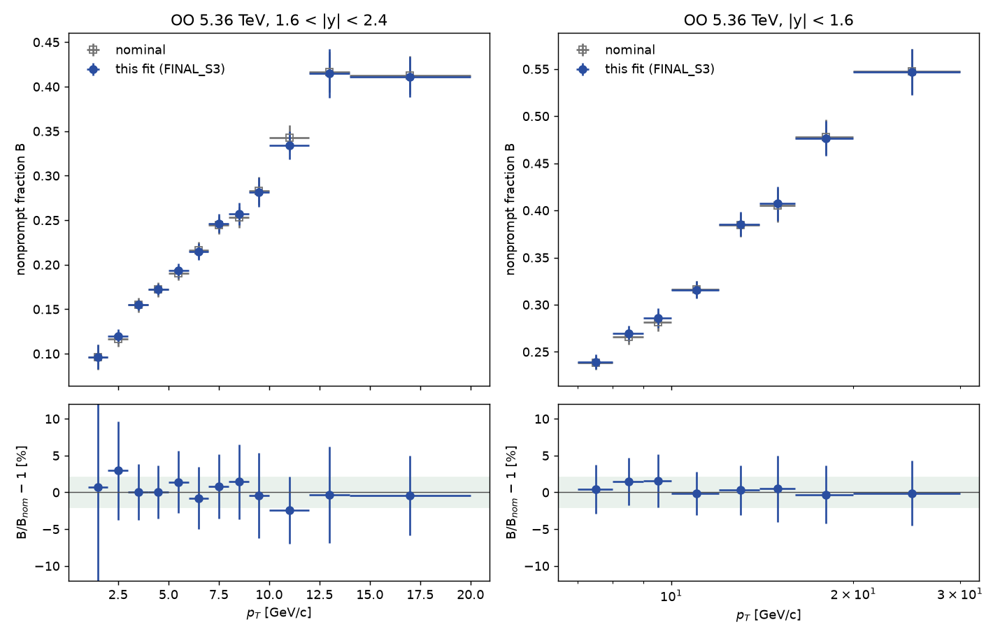

# OO J/ψ 질량–수명 2D fit: PDF별 규칙 (9월 단일 뮤온 acceptance 입력)

9월 OO 발표에 쓴 입력(JunChen 단일 뮤온 acceptance를 스킴에서 적용한 DATA·PR MC, 9월 NP gen 표본)으로 24일 작업(`../24_OO_sept_general_rule`)과 같은 규칙 스터디를 했다. 최종 설정 `FINAL_S1`로 19개 빈이 nominal B fraction과 ±2% 또는 0.138σ 이내에서 일치하고(0.138σ 이내 12빈), fwd 2–3은 +2.96%(0.41σ, 10/26 Codex 탐색 설정 재현)다. 방법과 결과는 [docs/REPORT.md](docs/REPORT.md), 웹 페이지 원본은 [docs/oo_fit_rules.html](docs/oo_fit_rules.html), prefit 변경 기록은 [docs/CHANGELOG_PREFIT.md](docs/CHANGELOG_PREFIT.md)에 있다.



## 폴더 구성 (9월 튜닝 폴더와 같은 구조)

| 경로 | 내용 |
|---|---|
| `mc_mass.C`, `ctau_pr.C`, `ctau_np.C`, `mass_window_screen.C`, `ctau_bkg.C`, `fit2d.C` | 단계별 적합 매크로 (`mass.C`는 범위 인자 없는 이전 DATA mass 매크로) |
| `roots/y*/{mc_mass,ctau_pr,ctau_np,mass,ctau_bkg,fit2d}/` | 단계별 fit 결과 ROOT (prefit과 최종 2D fit) |
| `figs/y*/<단계>/` | 단계별 fit 그림 |
| `figs_publish/y*/<단계>/` | 발표용 그림 (`run_publish.sh`) |
| `drawing/final_summary/` | 20빈 결과표(`summary.txt`, `report_table.txt`), PDF별 고정·제약·자유 표(`treatment.md`), nominal 비교 그림 |
| `config/prefit_settings.txt` | 빈별 prefit 선택: ctau 범위, 배경 성분 수, mass 배경 차수, NP·PR 성분 수, PR fit 범위 |
| `config/pr_calibration_windows.txt` | MC PR prefit의 범위와 파일 지문 (fit2d가 확인) |
| `config/pr_gap_ratios.txt`, `config/signal_purity.txt` | MC PR 간격비(`study/gap_ratios.py`), final fit S/B |
| `study/rules/FINAL_S1/` | 최종 2D fit knob 파일 (빈별 고정·제약·자유 설정) |
| `study/` | `production.py` (실행 본체, 빈별 파이프라인), `rules.py` (규칙 정의), `run_rules.py` (후보 규칙 fit), `prefit_variant.py` (prefit 변형을 별도 폴더에서 2D fit까지), `prefit_audit.C` (prefit 품질표), `group_table.py`, `treatment.py` |
| `study/runs/`, `study/prefit_variants/`, `study/scans/`, `study/logs_m/` | 후보 규칙·prefit 변형을 돌리면 생기는 실행 결과. 스터디 종료 후 삭제했고 요약만 `docs/evidence/`에 남겼다 |
| `inputs/` | DATA, PR MC, NP MC 입력 (9월 단일 뮤온 acceptance) |
| `docs/` | 보고서, 웹 페이지 원본과 그림(`docs/figs/`), 근거표(`docs/evidence/`) |
| `logs/` | 실행 로그 |

## 실행

ROOT 6.36.06 (`~/build/root-6.36.06/bin/root`)을 쓴다.

```bash
bash run_ctau_bins.sh                 # 전 단계: mc → pr → np → mass → bkg → 2d (빈마다 앞 단계가 끝나면 바로 다음 단계)
bash run_ctau_bins.sh --2d            # 최종 2D fit만 (roots/의 prefit 사용)
bash run_ctau_bins.sh --bkg --pt=8:9 --rapidity=mid
bash run_ctau_bins.sh --redraw        # 저장된 결과로 figs/ 다시 그리기 (재적합 없음)
bash run_publish.sh                   # figs_publish/ 만들기 (재적합 없음)
python3 drawing/report_table.py       # 결과표
python3 drawing/nominal_agreement.py  # nominal 비교 그림
python3 study/treatment.py            # PDF별 고정·제약·자유 표
```

`--2d` 실행이 끝나면 `drawing/final_summary/summary.txt`가 갱신된다. PR prefit을 다시 만들면 `config/pr_calibration_windows.txt`의 해당 빈 지문도 자동으로 갱신된다.
