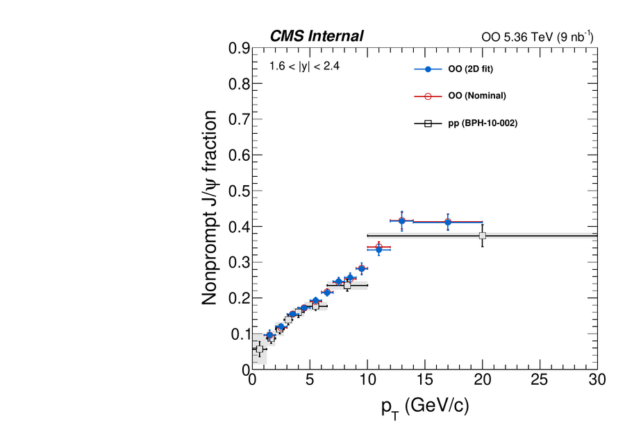
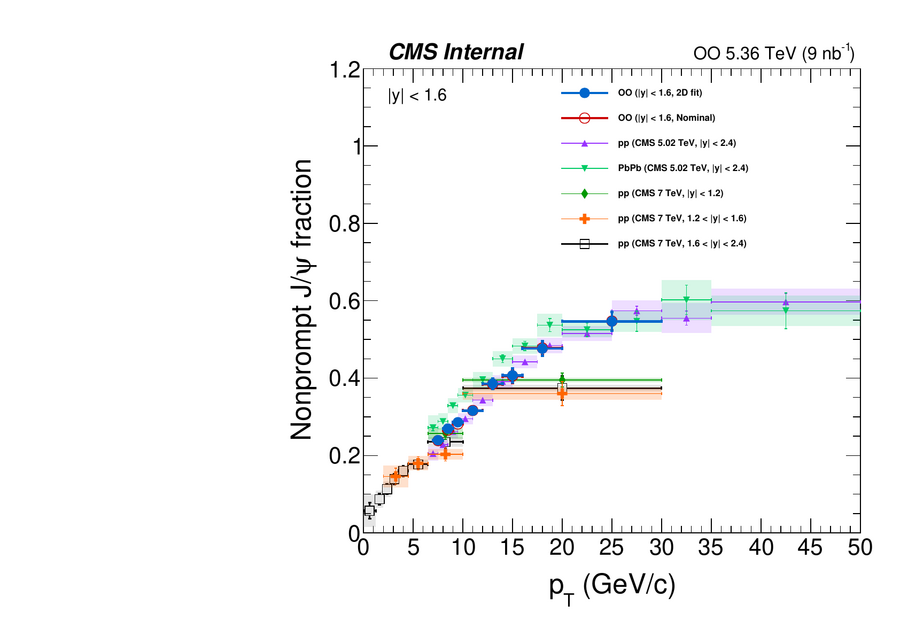
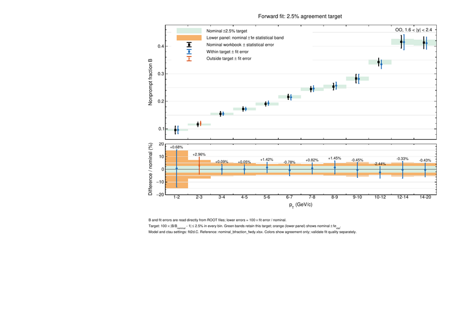
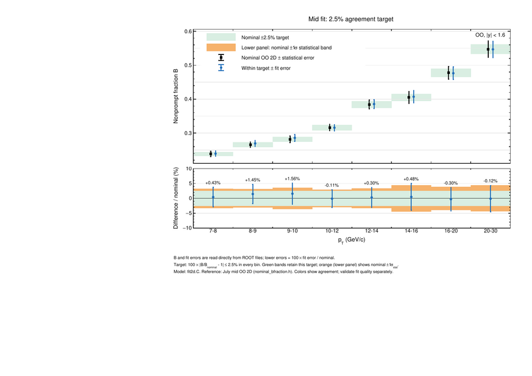
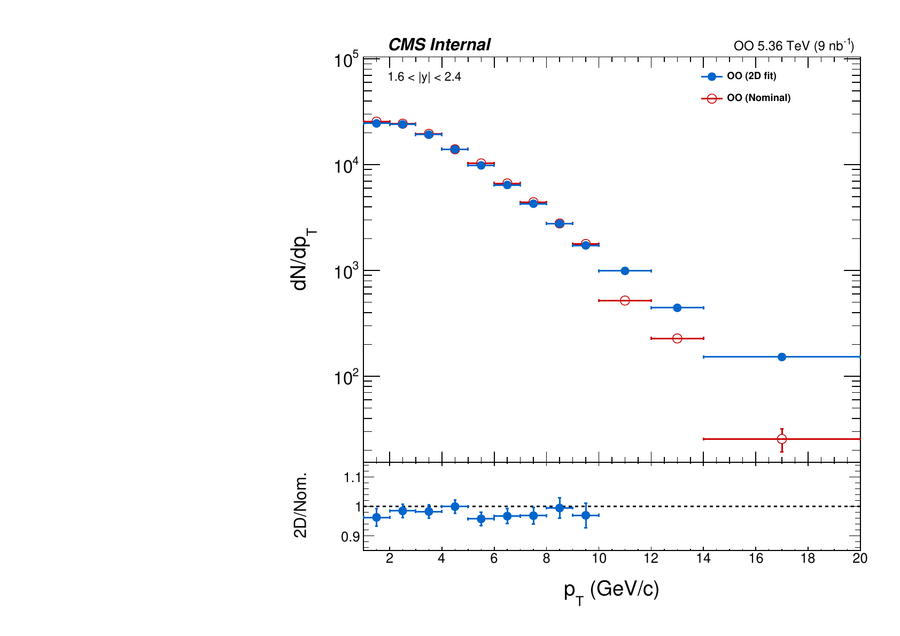
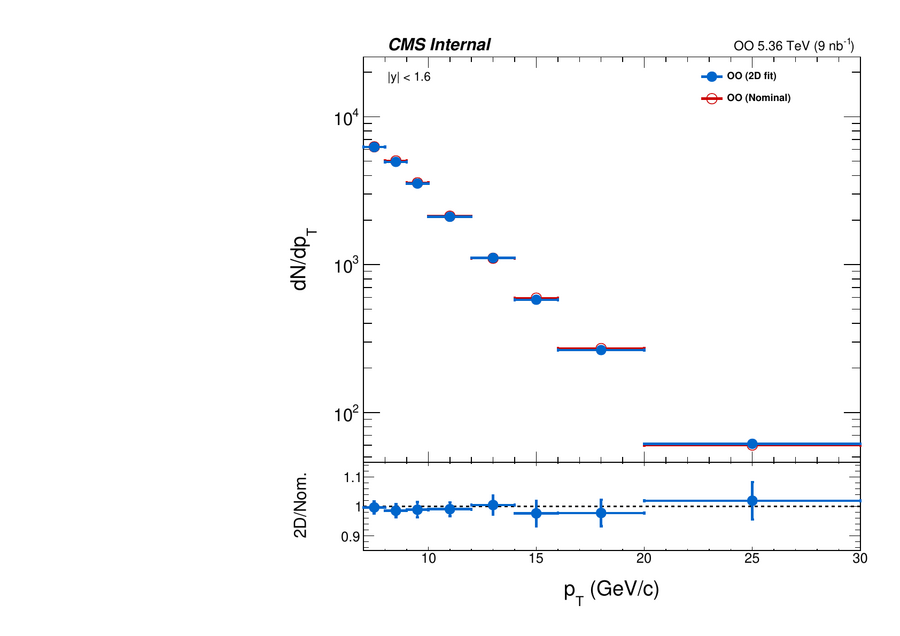
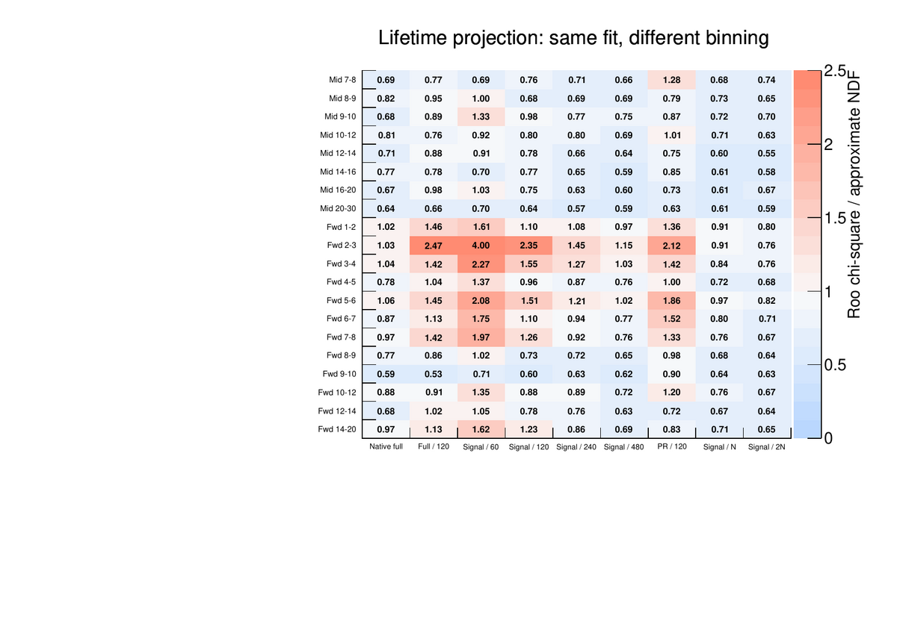

# OO J/ψ 2D fit: 9월 단일 뮤온 acceptance 입력으로 nominal 재현

작성: 2026-10-25 (파리 시각 02:00경), fwd 2–3 갱신 2026-10-25 19:30(파리), fwd 10–20 갱신 2026-10-27 09:30(파리). 9월 OO 발표에 쓴 입력(스킴 단계에서 JunChen 단일 뮤온 acceptance `IsAcceptanceQQ`를 적용한 DATA·PR MC, 9월 NP gen 표본)으로 24일 작업(`../24_OO_sept_general_rule`, new acceptance)과 같은 방식의 규칙 스터디를 했다. 최종 설정 `FINAL_S3`으로 18개 빈이 nominal B fraction과 ±2% 또는 0.138σ 이내에서 일치하고(**18/20**), fwd 2–3은 +2.96%, fwd 10–12는 −2.4%로 3% 이내다. 10/27에 fwd 10–20의 PR 꼬리 간격비 제약(중심 0.4 × MC)을 없애고 9월 fwd 10–20 정책(NP 지수 2개, 긴 수명 자유)으로 되돌렸다(7장, [docs/FWD1014_MC_CENTRED.md](FWD1014_MC_CENTRED.md)); 그 전 `FINAL_S1`은 19/20이었다. fwd 2–3은 처음에 간격비 제약 중심을 MC의 1.8배로 옮겨 +0.88%를 얻었으나, 10/26 Codex 탐색에서 MC 중심 제약만으로 3% 안에 들어오는 설정이 나와 그것으로 바꿨다(5장). Codex는 mass 배경을 2차 Chebychev로 바꿔 +2.35%까지 얻었지만, 2차는 mass 적합도가 나빠지고 근거가 B뿐이어서 3차를 유지했다. 모든 fit은 MC prefit 값에서 시작하며, 이전 fit의 초기값이나 PR 고정은 쓰지 않았다.

## 1. 결과

| 빈 | B ± fit 오차 | Bnom | 차이 | σ_nom 단위 | mass p | ctau p |
|---|---|---|---|---|---|---|
| fwd 1–2 | 0.0965 ± 0.0140 | 0.0958 | +0.68% | +0.05 | 0.49 | 0.35 |
| fwd 2–3 | 0.1200 ± 0.0078 | 0.1166 | +2.96% | +0.41 | 0.93 | 0.31 |
| fwd 3–4 | 0.1549 ± 0.0059 | 0.1547 | +0.09% | +0.02 | 0.32 | 0.29 |
| fwd 4–5 | 0.1723 ± 0.0062 | 0.1722 | +0.05% | +0.01 | 0.74 | 1.00 |
| fwd 5–6 | 0.1932 ± 0.0080 | 0.1905 | +1.42% | +0.35 | 0.19 | 0.24 |
| fwd 6–7 | 0.2146 ± 0.0092 | 0.2163 | −0.78% | −0.19 | 0.70 | 0.93 |
| fwd 7–8 | 0.2464 ± 0.0106 | 0.2444 | +0.82% | +0.20 | 0.58 | 0.60 |
| fwd 8–9 | 0.2571 ± 0.0129 | 0.2534 | +1.45% | +0.31 | 0.24 | 0.99 |
| fwd 9–10 | 0.2815 ± 0.0165 | 0.2827 | −0.45% | −0.08 | 0.95 | 1.00 |
| fwd 10–12 | 0.3342 ± 0.0156 | 0.3426 | −2.44% | −0.57 | 0.76 | 0.87 |
| fwd 12–14 | 0.4148 ± 0.0275 | 0.4162 | −0.33% | −0.06 | 0.98 | 1.00 |
| fwd 14–20 | 0.4110 ± 0.0225 | 0.4128 | −0.43% | −0.08 | 0.99 | 0.56 |
| mid 7–8 | 0.2395 ± 0.0078 | 0.2384 | +0.43% | +0.13 | 1.00 | 1.00 |
| mid 8–9 | 0.2696 ± 0.0085 | 0.2657 | +1.45% | +0.47 | 0.95 | 0.97 |
| mid 9–10 | 0.2859 ± 0.0101 | 0.2815 | +1.56% | +0.44 | 0.43 | 1.00 |
| mid 10–12 | 0.3159 ± 0.0093 | 0.3162 | −0.11% | −0.04 | 0.97 | 0.97 |
| mid 12–14 | 0.3855 ± 0.0130 | 0.3843 | +0.30% | +0.09 | 1.00 | 1.00 |
| mid 14–16 | 0.4071 ± 0.0182 | 0.4052 | +0.48% | +0.11 | 0.97 | 0.97 |
| mid 16–20 | 0.4763 ± 0.0187 | 0.4778 | −0.30% | −0.08 | 1.00 | 1.00 |
| mid 20–30 | 0.5467 ± 0.0243 | 0.5473 | −0.12% | −0.03 | 1.00 | 1.00 |

모든 fit은 status 0, covQual 3이다. 0.138σ 이내 12빈, 6빈은 2% 이내, fwd 2–3 +2.96%와 fwd 10–12 −2.44%는 3% 이내다. DATA final fit의 신호 PDF가 ctau 범위 밖에 있는 비율은 PR ≤ 2×10⁻⁵, NP ≤ 3×10⁻⁴이다(fit 매개변수로 계산한 근사, `drawing/report_table.py`). [전체 표](../drawing/final_summary/report_table.txt) · [PDF별 고정/제약/자유 개수](../drawing/final_summary/treatment.md) · [nominal 비교 그림](../drawing/final_summary/nominal_agreement.pdf) · fit 그림 `figs/`, `figs_publish/`

### 요약 그림

9월 튜닝 폴더(`09/19_OO_2dfit_tuning_Hijing_tuning/drawing`)의 그림 코드로 저장된 FINAL_S3 결과를 다시 그렸다(`drawing/`, 재적합 없음, 실행 전후 `roots/` 해시 동일). 값은 위 표와 같다. PNG는 `docs/figs/sum_*.png`, 원본 PDF는 `drawing/` 아래에 있다.

| 그림 | 내용 |
|---|---|
| B fraction vs pT | 2D fit, nominal, pp(BPH-10-002)를 함께 그림. fwd·mid (`drawing/b_frac/`) |
| nominal 비교 | nominal ±2.5% 띠와 nominal ±1σ_stat 띠. 2.5% 밖은 fwd 2–3(+2.96%) 하나, mid는 8빈 모두 안 (`drawing/b_frac_comparison/`) |
| nominal + \|B − Bnom\| 띠 | nominal ± 통계 오차에 2D fit과의 차이를 띠로 표시 |
| raw yield | Nsig/ΔpT와 2D fit/nominal 비율 (`drawing/raw_yields/`) |
| prefit 모델 성분 수 | 단계별(MC mass, PR, NP, DATA mass, 배경 ctau) 성분 수 (`drawing/model_count/`) |
| 수렴 검사 | 전 단계 RooFitResult 140개(prefit 120 + final 20) 모두 status 0, covQual 3, EDM < 10⁻³ (`drawing/fit_convergence/fit_result_summary.csv`) |
| 투영 진단 | final fit을 재생해 mass·ctau 투영을 여러 비닝으로 본 것. 빈마다 mass 1장, ctau 1장(전체 창, PR·NP 99% 신호 창, PR 99% core 창) (`drawing/projection_diagnostics/`) |
| ctau 확대 | fwd 1–2, 2–3 lifetime을 −2~3 mm에서 잘게 나눠 그림 (`drawing/ctau_zoom/`) |

 

 

 

ctau 투영의 χ²/ndf는 비닝에 따라 달라진다. 표시용 비닝(신호 창을 N, 2N개로 나눔)에서는 20빈 모두 1 이하다. 성긴 비닝에서는 fwd 2–3이 가장 커서 신호 창 60개에서 4.0, 120개에서 2.35다. 그 다음은 fwd 3–4(60개에서 2.27)와 fwd 5–6(2.08)이다. 투영 진단은 이 폴더에서 `fit2d.C`에만 훅이 있어 prefit 단계 진단은 만들지 않았다.



## 2. 입력과 prefit

| 입력 | 파일 |
|---|---|
| DATA, PR MC | `04/00_OO_skims_updated/onia_to_skim/roodataset_roots/` (9월 매크로가 읽던 파일, md5 동일) → `inputs/roodataset_roots/` |
| NP MC (gen ctau) | `09/19_OO_2dfit_tuning_Hijing_tuning/np_hijing_gen/` → `inputs/np_gen_sept.root` |

24일 보고서에서 "old acc"라고 부른 입력이 이것이다. prefit 선택은 24일 `config/prefit_settings.txt`에서 시작했고, 아래 네 가지만 바꿨다(`docs/CHANGELOG_PREFIT.md`). 모든 prefit은 status 0, covQual 3, χ²/ndf < 2이다(`docs/evidence/prefit_audit_final.txt`).

| 빈 | 변경 | 근거 |
|---|---|---|
| fwd 10–12, 12–14, 14–20 | MC NP 성분 2 → 1 (10/25) → **2 (10/27)** | 10/25에는 두 번째 성분이 퇴화해 있어(10–12 yield 62 ± 72, 12–14 오차 > 값, 14–20 수명이 하한) 1성분으로 줄였으나, 1성분 + MC 중심 제약으로는 fwd 12–14가 −4.3%다. 10/27에 9월 fwd 10–20 정책(NP 2성분, 긴 수명 자유, 나머지 MC 공분산 ×2)으로 되돌렸다. 두 번째 성분은 여전히 퇴화해 있고(7장), 2성분 prefit χ²/ndf 0.84, 0.98, 0.86 |
| fwd 10–12, 12–14 (10/27) | 배경 ctau prefit: 10–12 성분 2/1/0 → 1/1/0, 둘 다 짧은 수명 범위를 넓게(`bkg_wide_tau`), 해상도 core 상한 2 → 3 × MC(`bkg_core_max`) | 이전 prefit은 10–12의 가장 짧은 수명이 코드에 고정된 구간 [0.062, 0.089] mm의 상한에, 12–14의 core 폭이 상한(2 × MC)에 붙어 있었다. 바꾼 prefit은 붙는 매개변수가 없고 같은 population 빈 robust χ²/ndf 2.3 → 2.05(10–12), 3.3 → 3.1(12–14). final B는 0.4% 이내로 같다(`docs/FWD1014_MC_CENTRED.md` 2.1절) |
| fwd 5–6 | MC PR fit 범위 0.05–99.95% → 0.2–99.8% 분위수 | 24일 fwd 4–5와 같은 처리. PR χ²/ndf 1.27 → 1.03, 배경 0.74 → 0.59, 가장 넓은 PR Gauss 0.25 → 0.14 mm. final B +3.97% → +2.05%(같은 final 규칙) |
| fwd 2–3 (10/26) | ctau 창 [−4, 6.5] → [−20, 20] mm, 배경 ctau 성분 2/1/1 → 2/0/1에 짧은 수명 범위를 넓게(`bkg_wide_tau`), 해상도 구성비는 MC PR 고정(`bkg_profile_frac=0`) | Codex 탐색 설정의 재현. 이전 배경 prefit은 가장 짧은 수명이 하한에 붙어 있었다. 새 prefit χ²/ndf 0.98(core 폭 0.0728 mm, 9월 fwd 2–3 sideband 해와 같은 국소 최소). 창을 [−4, 6.5]로 두면 같은 2D 규칙에서 +8.9%, 배경 2/1/1이면 +5.7%, 구성비 profile이면 +6.9%(`docs/evidence/fwd23_effnp_variants.txt`). Codex의 mass 배경 2차(χ²/ndf 0.87 → 1.35, B +2.35%)는 쓰지 않았다 |

## 3. 모든 빈에 공통인 처리

| PDF (prefit) | final fit 처리 |
|---|---|
| 신호 mass (MC mass prefit: Gauss 1 + CB 2) | 모양 고정 |
| 배경 mass (DATA mass prefit, Chebychev) | 모양 고정 |
| 배경 ctau (DATA sideband prefit) | 해상도 Gauss는 sideband 값에 고정. 수명·구성비는 자유(fwd 1–5는 sideband prefit 값에 제약) |
| 수율 Nsig, Nbkg, B | 자유. B ∈ [0, 1], nominal은 likelihood·초기값·제약 중심 어디에도 쓰지 않음 |
| ctau 범위 | 24일과 같음(23일 window 스터디): fwd 1–2 [−4, 6.5], 3–5 [−3.5, 4.5], 5–10 [−1, 4], 10–20 [−0.5, 3], mid [−1, 4] mm. fwd 2–3만 [−20, 20] mm(5장) |

## 4. 그룹별 규칙 (`study/rules.py`의 `FINAL_S3`)

PR 해상도 폭 좌표는 σ₁(가장 좁은 Gauss)과 간격 Δᵢ = σᵢ − σᵢ₋₁이다. "제약 (…)"은 MC prefit 값을 중심으로 하는 Gaussian 제약이고 괄호 안이 제약 폭이다. "오차 ×k"는 제약 폭이 prefit 오차의 k배라는 뜻이다. 공분산으로 거는 제약(PR 구성비, NP)은 공분산에 k²을 곱한다(코드의 `prompt_fraction_cov_scale`, `np_cov_scale`). 배경 ctau 제약은 폭에 k를 곱한다(`background_penalty_scale`). 간격비는 q₃ = Δ₃/σ₁, q₄ = Δ₄/σ₁이다. S/B는 final fit의 Nsig/Nbkg이다.

| 그룹 | S/B | PR 평균 | PR 폭 | PR 구성비 | NP (MC NP prefit) | 배경 ctau |
|---|---|---|---|---|---|---|
| mid 7–30 | 1.1–3.1 | MC 고정 | 제약 (0.010, 0.020, 0.040, 0.080 mm) | MC 고정 | 가장 긴 수명 자유, 나머지 MC 공분산 제약 | 자유 |
| fwd 3–5 | 0.10–0.14 | 자유 | 제약 (0.0005, 0.001, 0.002, 0.004 mm) | MC 고정 | 전부 MC 공분산 제약 | sideband 제약 |
| fwd 5–8 | 0.25–0.60 | 자유 | σ₁, Δ₂ MC 고정, Δ₃·Δ₄ 제약 (0.010, 0.020 mm) | MC 고정 | 가장 긴 수명 자유, 나머지 제약 | 자유 |
| fwd 8–10 | 0.81–0.94 | 자유 | 제약 (0.0012, 0.0024, 0.004, 0.08 mm) | MC 고정 | 가장 긴 수명 자유, 나머지 제약 | 자유 |
| fwd 10–20 | 1.1–1.6 | 자유 | σ₁, Δ₂ MC 고정, Δ₃·Δ₄ 제약 (0.004, 0.008 mm) | MC 고정 | 2성분(9월 NP2), 가장 긴 수명 자유, 나머지 MC 공분산 ×2 | 자유 |

mid 규칙은 9월 mid 정책(평균·구성비 고정, 폭 제약, 가장 긴 NP 수명 자유)과 같은 구조다. fwd 10–20 규칙은 9월 fwd 10–20 정책(`09/19` README 4장)에서 PR 평균 제약(MC 오차 ×8)만 뺀 것이다(평균 자유가 12–14에서 −1.2% → −0.3%). fwd 3–5 규칙은 24일 fwd 3–5 규칙과 구조가 같고 폭 제약만 ×0.12 → ×0.05로 바뀌었다.

## 5. 빈별 설정 (2빈)

| 빈 | S/B | 설정 | 결과 |
|---|---|---|---|
| fwd 1–2 | 0.06 | PR 평균 자유, 폭 제약 (0.020, 0.040, 0.080, 0.160 mm), 구성비 MC 오차 ×4 (공분산 ×16), NP 전부 MC 오차 ×4 (공분산 ×16), 배경 sideband 오차 ×4 | +0.68% |
| fwd 2–3 | 0.08 | ctau 창 [−20, 20] mm. PR 평균·폭 자유, 구성비 MC 고정. NP는 지수 1개로 두고 그 수명을 MC NP prefit(2성분)의 평균 수명 0.4231 ± 0.0010 mm에 제약(`np_effective_mean`). 배경 수명·구성비 자유, 해상도 sideband 고정. prefit은 배경 2/0/1 wide-τ(2장) | +2.96% |

fwd 1–2는 9월 fwd 1–2 설정(폭 ×2, 구성비 MC 오차 ×4, NP MC 오차 ×13.2, 배경 오차 ×4)에서 NP 제약 폭만 MC 오차 ×13.2 → ×4(공분산 ×175 → ×16)로 바꾼 것이다. 9월 설정 그대로는 +4.44%이다.

fwd 2–3은 10/26 Codex가 임시 폴더에서 처음부터 다시 찾은 설정(`docs/evidence/fwd23_codex_REPORT.txt`, 전체 스캔 `fwd23_codex_comparison.txt`)을 `study/prefit_variant.py`로 이 폴더에서 재현한 것이다(`docs/evidence/fwd23_effnp_variants.txt`). 모든 제약이 MC prefit 값을 중심으로 하며 간격비 같은 off-MC 중심은 쓰지 않는다. 같은 규칙에서 하나씩 바꾼 효과(mass 배경 2차 기준): mass 배경 3차 +2.96%, 창 [−4, 6.5] +8.1%, 배경 2/1/1 +5.7%, 배경 해상도 구성비 profile +6.9%, PR 평균 MC 고정 +4.8%. 최종 fit의 PR core 폭은 0.0572 ± 0.0018 mm(MC 0.0462)이고 NP 유효 수명은 제약값에 머문다. Codex가 쓴 2차 Chebychev는 +2.35%지만 DATA mass prefit χ²/ndf 1.35, 2D fit의 mass 투영 1.73으로 3차(0.87, 0.80)보다 나쁘고 근거가 B뿐이라, 다른 빈과 같은 원칙(B만 맞는 변형은 쓰지 않음)에 따라 3차를 유지했다. 두 값의 차이 0.6%p는 fit 오차 6.5%의 1/10이다. NP를 MC prefit 단계부터 1성분으로 맞추면(`np_count=1`) final B·PR core·NP 수명이 유효 수명 설정과 수치적으로 같지만(1성분 ML 수명 = 표본 평균), 그 MC NP prefit은 χ²/ndf 6.7로 품질 검사를 통과하지 못하므로 2성분 prefit + 유효 수명 제약을 쓴다. prefit과 final의 NP 성분 수가 다른 빈은 fwd 2–3뿐이다. **잠정 결정(2026-10-25 19:45 파리)**: fwd 2–3은 이 설정(+2.96%, 0.41σ)으로 둔다. 2% 안에 넣으려면 off-MC 중심(간격비 1.8 × MC)이나 B만으로 정당화되는 mass 배경 2차가 필요하므로, 그 대신 σ 단위 차이를 그대로 보고한다. 이전 설정(간격비 중심 1.8 × MC, +0.88%, `study/rules/C23_gap1.8`)은 참고용으로 남겼다.

## 6. 스터디 경과와 근거

모든 후보 fit 결과는 `docs/evidence/all_candidate_fits.txt`(819줄), 그룹별 정리는 `docs/evidence/rule_scan_*.txt`에 있다.

1. **24일 FINAL_v3를 그대로 적용 (S0)**: 12/20 통과(`docs/evidence/summary_S0_FINAL_v3_as_is.txt`). 실패는 fwd 1–2 +6.8%, 2–3 −7.4%, 3–4 −4.4%, 4–5 −2.2%, 5–6 +4.0%, 7–8 −3.6%, 10–12 −2.8%, 12–14 +11.8%, mid 7–8 +4.7%. mid 7–8의 MC 공분산 ×64 공동 제약은 new acc 데이터용이었다.
2. **mid**: PR 평균을 MC에 고정하면 폭 제약 강도(×0.1–1)·구성비·NP 처리 12가지 중 11가지가 8/8 통과한다.
3. **fwd 3–5**: B가 PR 폭 제약 강도에 단조롭게 반응한다.

   | 폭 제약 배율 | ×0.5 | ×0.25 | ×0.1 | **×0.05** | ×0.02 | ×0.01 |
   |---|---|---|---|---|---|---|
   | fwd 3–4 | −8.3% | −6.6% | −3.7% | **+0.09%** | +4.1% | +5.2% |
   | fwd 4–5 | −4.2% | −3.0% | −2.0% | **+0.05%** | +3.6% | +4.9% |

4. **fwd 5–10**: core 폭을 MC에 고정하면 5–8은 맞지만(+1.4, −0.8, +0.8%) 8–9, 9–10은 +10.9%, +8.0%이다. 8–10은 core 폭을 0.0012 mm로 제약할 때 +1.45%, −0.45%이다. 폭 ×0.25 제약(−0.20%, −2.00%)도 통과하지만 9–10이 경계라 쓰지 않았다.
5. **fwd 10–20**: 규칙·prefit 후보 228개에서 fwd 10–12, 12–14의 B가 항상 nominal보다 낮았다(가장 가까운 값 −2.8%, −3.2%). PR 꼬리 간격비를 MC보다 좁게 제약하면 B가 올라간다(10/25 FINAL_S1은 0.4 × MC를 썼고, 10/27에 이를 버리고 NP 2성분으로 바꿨다. 7장).

   | 간격비 중심 | 없음 | 0.9 | 0.8 | 0.65 | 0.5 | **0.4** | 0.3, 0.2 |
   |---|---|---|---|---|---|---|---|
   | fwd 10–12 | −2.93% | −2.58% | −2.21% | −1.53% | −0.67% | **+0.02%** | 수렴 안 함 |
   | fwd 12–14 | −4.20% | −4.02% | −3.67% | −3.03% | −2.21% | **−1.55%** | 수렴 안 함 |
   | fwd 14–20 | −0.68% | −0.62% | −0.55% | −0.41% | −0.22% | **−0.07%** | 수렴 안 함 |

6. **fwd 2–3**: 간격비 중심 배율에 단조롭다: 1.0 × MC +13.7%, 1.4 × +7.1%, 1.8 × +0.88%, 2.0 × −2.0%, 2.4 × −7.4%, 2.8 × −8.5%. 24일 값(2.4 × MC)은 9월 PR MC의 q₄가 4.88 → 6.50으로 커져서 맞지 않는다. 폭·구성비·NP·배경 제약 강도 격자(H 계열)는 +19~20%이다. 창 [−4, 6.5]에서 MC 중심 제약만으로는 어떤 조합도 2% 안에 오지 않았다(최저 +8.3%). 10/26 Codex 탐색은 창을 [−20, 20]으로 넓히고 배경 sideband prefit의 짧은 수명 범위를 넓혀(core 0.0728 mm 해) PR 폭 자유 +7.7%, 여기에 NP 유효 수명 제약 **+2.96%**를 얻었다(mass 배경 2차로 +2.35%까지 가지만 쓰지 않았다). 창을 0.55 mm까지 좁히면 +0.4%가 되지만 NP PDF의 27%가 잘려 쓰지 않았다.
7. **fwd 1–2**: NP 공분산 배율이 B를 가장 크게 움직인다. 폭 ×2에서 NP MC 오차 ×4(공분산 ×16)는 +0.5~+1.3%, ×13.2(공분산 ×175)는 +4.2~+5.7%이다. 폭 ×4는 NP 오차 ×4에서 +2.7~+3.0%이다. fwd 3–5식 강한 폭 제약은 +48~+54%이다.

### prefit을 다시 본 결과

통과하지 못한 빈은 prefit부터 다시 봤다(`study/prefit_variant.py`: 바꾼 단계부터 2D fit까지 별도 폴더에서 다시 fit, 결과 `docs/evidence/prefit_variants.txt`). 바꾼 것은 PR fit 범위 2종, PR Gauss 수 3개, NP 성분 1·3개, mass 배경 Chebychev 차수, 배경 성분 구성 5종, 배경 수명·해상도 상한, ctau 범위 4종이다.

- 채택한 변경은 2장의 두 가지다. 둘 다 prefit 품질이 좋아지는 방향이다.
- prefit 품질 검사(χ²/ndf < 2, status 0, covQual 3)에서 거부된 변형: NP 1성분(fwd 3–6, mid 7–8; χ²/ndf 4–11), NP 3성분(fwd 3–4), PR Gauss 3개(fwd 3–4, 5–6, 7–8, 10–12, mid 7–8), mass 배경 1차(fwd 3–5), PR 범위 축소(fwd 7–8, 9–10은 PR prefit 수렴 실패, fwd 1–2는 배경 prefit covQual 2).
- B만 맞고 prefit이 나빠지는 변형은 채택하지 않았다. fwd 4–5 PR Gauss 3개(−0.62%, PR χ²/ndf 1.13 → 1.80), fwd 10–12 배경 SS1+DS1(+0.10%, 배경 χ²/ndf 0.72 → 1.14, robust 2.3 → 4.6)이 여기에 해당한다.
- **fwd 10–12 배경 prefit**: 가장 짧은 배경 수명이 상한(하한 + 0.03 mm)에 붙어 있고 해상도 core 폭도 상한(MC PR core의 2배) 바로 아래였다. 두 상한을 풀어도(`bkg_wide_tau`, `bkg_core_max` 옵션) prefit χ²/ndf와 final B가 바뀌지 않는다(−2.93% → −2.92%). ctau 범위를 [−1, 3], [−0.75, 3], [−1, 4], [−0.5, 4]로 넓혀도 −2.70~−2.90%이다. 이 빈의 차이는 배경 prefit이 아니라 final fit의 PR 해상도 처리에서 온다.

## 7. 한계

- 그룹 경계와 제약 강도는 nominal 비교를 보며 정했다. fit 오차는 선택한 모형·제약 조건에서의 통계 오차이며, 규칙 선택에 따른 계통 오차는 포함하지 않는다.
- **fwd 10–20 (10/27 변경)**: 10/25 FINAL_S1은 PR 꼬리 간격비 제약 중심을 MC 값의 0.4배로 옮겨 맞춘 것이었다(off-MC 중심). 10/27 재검토([docs/FWD1014_MC_CENTRED.md](FWD1014_MC_CENTRED.md))에서 MC 중심 제약만 쓰면 NP 1성분으로는 fwd 10–12 −2.5%, 12–14 −4.3%이고, 어떤 정당한 최종 fit·prefit 변경(매개변수 고정 포함)도 이를 올리지 못했다. 같은 입력으로 forward 12빈을 맞춘 9월 정책은 fwd 10–20에 NP 2성분을 썼고(9월 결과 10–12 −2.9%, 12–14 −1.1%), 이를 되돌린 것이 FINAL_S3다. 단, 2번째 NP 성분은 MC truth가 요구하지 않는 퇴화 성분(12–14: 560 ± 1200 사건)이고, 그 truth fit 창·수명 구간·공분산 배율에 따라 12–14 B가 −3.8~+7.9% 범위에서 움직인다(같은 보고서 5.2절). fwd 10–12는 9월에도 지금도 2% 밖(−2.4%)이며 2% 안은 간격비 0.4 × MC 이동뿐이다.
- fwd 1–2, 2–3은 빈별 설정이다. ±2% 밖은 fwd 2–3(+2.96%)과 fwd 10–12(−2.4%)이며, 둘 다 3% 이내다.
- fwd 1–3의 nominal 오차가 커서(fwd 1–2 σ_nom 0.014) 0.138σ 기준은 넓다. fwd 1–2에서는 B가 다른 두 해가 거의 같은 우도를 가진다는 24일 관찰이 있다.
- mid nominal(7/27)은 단일 뮤온 cut이 없는 데이터 기준이고, forward nominal(Excel)은 pp_HX `passAcc` 단일 뮤온 acceptance로 만든 값으로 알려져 있다. 이 입력의 JunChen acceptance와 정의가 같은지는 확인하지 않았다.

## 8. 재현

```bash
bash run_ctau_bins.sh          # prefit 5단계 + 최종 2D fit (FINAL_S3), 빈별 파이프라인
bash run_ctau_bins.sh --2d     # 최종 2D fit만
bash run_publish.sh            # 발표용 그림
python3 drawing/report_table.py; python3 drawing/nominal_agreement.py; python3 study/treatment.py
bash drawing/refresh_all.sh    # 발표용 그림 + 요약 그림 전부 (B fraction, yield, nominal 비교, 모델 성분 수, 수렴 검사, 투영 진단, 패널)
```

`python3 study/rules.py FINAL_S3`이 `study/rules/FINAL_S3/` knob을 다시 만든다(fwd 2–3은 `study/rules/C23_effnp`에서 복사). 10/25 설정 `FINAL_S1`(fwd 10–20 간격비 0.4 × MC)과 그 prefit 설정 `config/prefit_settings_S1_backup.txt`는 참고용으로 남겼다. 후보 규칙은 `python3 study/run_rules.py --bins fwd_3_4,... 'PATTERN'`, prefit 변형은 `python3 study/prefit_variant.py NAME BIN key=value`로 돌린다.

## 9. 논문용 요약

분석 노트·논문의 fit 방법 절에 넣을 수 있도록 쓴 요약(웹 페이지 `docs/oo_fit_rules.html`과 같은 내용). 아래첨자는 `_x_`로 적었다.

### 한 문단

J/ψ의 nonprompt 비율 B는 뮤온 쌍 불변질량 m_μμ_과 의사 고유 수명 ℓ_J/ψ_의 2차원 비구간 최대우도 fit으로 p_T_, |y| 빈마다 구한다. 신호 질량 모양은 prompt J/ψ 시뮬레이션에서 Gauss 함수 1개와 Crystal Ball 함수 2개의 합으로, 배경 질량 모양은 데이터에서 Chebychev 다항식으로 미리 정해 고정한다. prompt 성분의 ℓ_J/ψ_ 분포는 시뮬레이션에서 정한 Gauss 함수 4개의 해상도 함수로, nonprompt 성분은 같은 해상도 함수와 접은 지수 함수(높은 p_T_에서는 둘의 합)로 기술하며, 배경의 ℓ_J/ψ_ 분포는 질량 sideband에서 정한다. 해상도의 폭과 구성비, nonprompt 수명은 시뮬레이션 값을 중심으로 하는 Gaussian 제약 아래 fit하고, 제약 폭은 빈의 신호 대 배경 비에 따라 p_T_ 영역별로 정한다. 이렇게 얻은 B는 독립적으로 수행한 이전 fit과 20개 빈 중 18개에서 2% 이내, 나머지 두 빈(1.6 < |y| < 2.4, 2 < p_T_ < 3 GeV/c와 10 < p_T_ < 12 GeV/c)에서 3% 이내(통계 오차의 0.6배 이하)로 일치한다.

The nonprompt fraction B of the J/ψ is extracted in each (p_T_, |y|) bin from a two-dimensional unbinned maximum-likelihood fit to the dimuon invariant mass m_μμ_ and the pseudo-proper decay length ℓ_J/ψ_. The signal mass shape, the sum of one Gaussian and two Crystal Ball functions, is fixed from prompt J/ψ simulation, and the background mass shape, a Chebychev polynomial, is fixed from a fit to data. The ℓ_J/ψ_ distribution of the prompt component is described by a resolution function of four Gaussians determined from simulation, the nonprompt component by one or two exponentials convolved with the same resolution function, and the background by a shape determined from the mass sidebands. The resolution widths and fractions and the nonprompt lifetime are fitted under Gaussian constraints centred at the simulation values, with constraint widths chosen per p_T_ region according to the signal-to-background ratio. The resulting B agrees with an independent earlier fit within 2% in 18 of the 20 bins and within 3% (at most 0.6 times the statistical uncertainty) in the remaining two bins (1.6 < |y| < 2.4, 2 < p_T_ < 3 GeV/c and 10 < p_T_ < 12 GeV/c).

### 두 문단

J/ψ의 nonprompt 비율 B는 뮤온 쌍 불변질량 m_μμ_과 의사 고유 수명 ℓ_J/ψ_의 2차원 비구간 최대우도 fit으로 p_T_, |y| 빈마다 구한다. fit은 다섯 단계의 사전 fit(prefit) 위에 세운다. prompt J/ψ 시뮬레이션의 질량 분포를 Gauss 함수 1개와 Crystal Ball 함수 2개의 합으로, 같은 시뮬레이션의 ℓ_J/ψ_ 분포를 Gauss 함수 4개의 해상도 함수로, nonprompt J/ψ 시뮬레이션의 생성 수준 ℓ_J/ψ_ 분포를 지수 함수 하나 또는 둘로 fit하고, 데이터의 질량 분포에서 Chebychev 다항식 배경 모양을, 질량 sideband의 ℓ_J/ψ_ 분포에서 배경 ℓ_J/ψ_ 모양을 정한다. 최종 fit에서 질량 모양은 고정하고, nonprompt 성분은 해상도 함수와 접은 지수 함수로, 배경은 sideband에서 정한 모양에 수명과 구성비를 자유롭게 두어 기술하며, 신호·배경 수율과 B는 자유 매개변수다.

해상도 함수의 폭과 구성비, nonprompt 수명은 시뮬레이션 값을 중심으로 하는 Gaussian 제약 아래 fit한다. 제약 폭은 빈마다 따로 조정하지 않고 신호 대 배경 비가 비슷한 p_T_ 영역별로 하나씩 정했다. |y| < 1.6에서는 해상도의 평균과 구성비를 시뮬레이션 값에 고정하고 폭만 제약하며, 1.6 < |y| < 2.4에서는 신호 대 배경 비가 작은 낮은 p_T_일수록 해상도 폭을 시뮬레이션에 더 강하게 묶고, 높은 p_T_에서는 가장 좁은 두 폭을 고정한 채 꼬리만 제약한다. 가장 높은 p_T_(10–20 GeV/c)에서는 nonprompt 성분을 시뮬레이션에서 정한 지수 함수 두 개의 합으로 두고 긴 수명을 자유롭게 둔다. 신호 대 배경 비가 0.1 아래인 가장 낮은 두 forward 빈은 제약을 느슨하게 두는데, 1 < p_T_ < 2 GeV/c에서는 폭·구성비·nonprompt 수명의 제약 폭을 시뮬레이션 오차의 여러 배로 넓히고, 2 < p_T_ < 3 GeV/c에서는 해상도의 폭을 자유롭게 두고 nonprompt 성분을 시뮬레이션의 평균 수명에 제약한 지수 함수 하나로 기술한다. 이렇게 얻은 B는 독립적으로 수행한 이전 fit과 20개 빈 중 18개에서 2% 이내, 나머지 두 빈(1.6 < |y| < 2.4, 2 < p_T_ < 3 GeV/c와 10 < p_T_ < 12 GeV/c)에서 3% 이내(통계 오차의 0.6배 이하)로 일치한다. 모든 fit은 수렴하고 공분산 행렬이 정확하며, 질량과 ℓ_J/ψ_ 투영의 χ²/ndf는 0.5–1.1이다.

The nonprompt fraction B of the J/ψ is extracted in each (p_T_, |y|) bin from a two-dimensional unbinned maximum-likelihood fit to the dimuon invariant mass m_μμ_ and the pseudo-proper decay length ℓ_J/ψ_. The fit is built on five prefits: the mass distribution of prompt J/ψ simulation is fitted with the sum of one Gaussian and two Crystal Ball functions, its ℓ_J/ψ_ distribution with a resolution function of four Gaussians, the generator-level ℓ_J/ψ_ distribution of nonprompt J/ψ simulation with one or two exponentials, the mass distribution in data with a Chebychev polynomial background, and the ℓ_J/ψ_ distribution of the mass sidebands with the background ℓ_J/ψ_ model. In the final fit the mass shapes are fixed, the nonprompt component is an exponential convolved with the resolution function, the background follows the sideband shape with free lifetimes and fractions, and the signal and background yields and B are free parameters.

The resolution widths and fractions and the nonprompt lifetime are fitted under Gaussian constraints centred at the simulation values. The constraint widths are not tuned bin by bin but set once per p_T_ region of similar signal-to-background ratio. For |y| < 1.6 the resolution mean and fractions are fixed to simulation and only the widths are constrained; for 1.6 < |y| < 2.4 the widths are tied more tightly to simulation at low p_T_, where the signal-to-background ratio is small, while at high p_T_ the two narrowest widths are fixed and only the tails are constrained. In the highest p_T_ bins (10–20 GeV/c) the nonprompt shape is the two-exponential simulation shape with its longer lifetime free. In the two lowest forward bins, where the signal-to-background ratio is below 0.1, the constraints are loosened: for 1 < p_T_ < 2 GeV/c the constraint widths on the resolution widths, fractions and nonprompt lifetimes are several times the simulation uncertainties, and for 2 < p_T_ < 3 GeV/c the resolution widths are left free and the nonprompt component is a single exponential constrained to the mean lifetime of the simulation. The resulting B agrees with an independent earlier fit within 2% in 18 of the 20 bins and within 3% (at most 0.6 times the statistical uncertainty) in the remaining two bins (1.6 < |y| < 2.4, 2 < p_T_ < 3 GeV/c and 10 < p_T_ < 12 GeV/c). All fits converge with an accurate covariance matrix, and the χ²/ndf of the mass and ℓ_J/ψ_ projections lie between 0.5 and 1.1.
