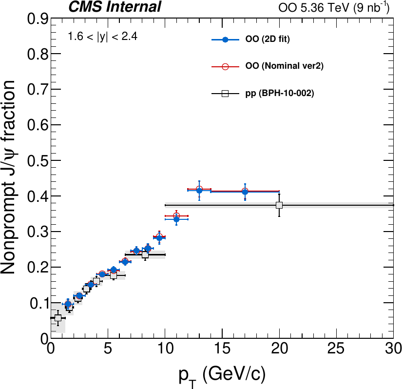
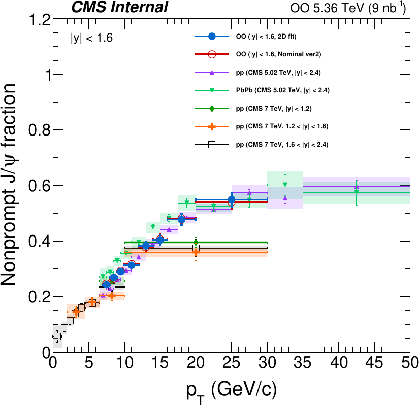
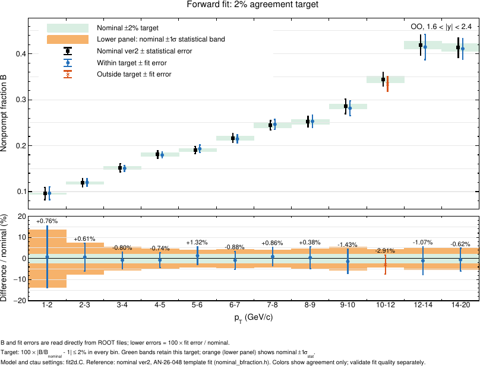
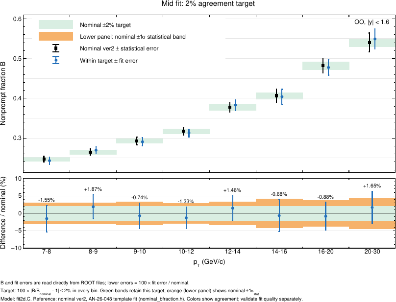
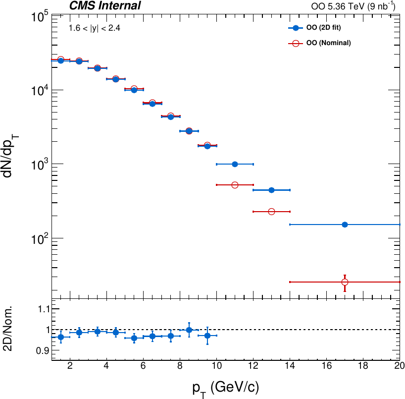
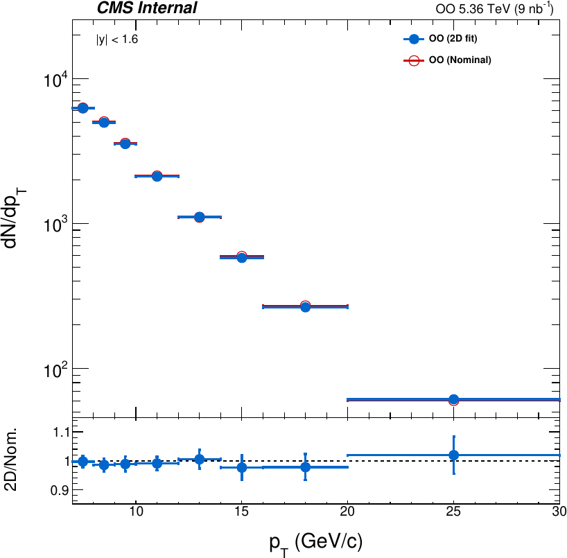
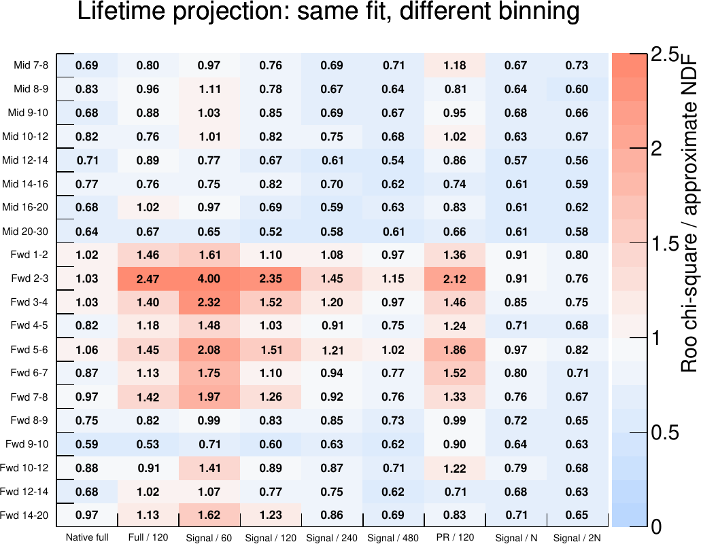

# OO J/ψ 2D fit: nominal ver2 기준 최종 설정 FINAL_V2

작성: 2026-10-28 (파리 시각 17:40경). 25일 폴더(`../25_OO_sept_acc_general_rule`, FINAL_S3)와 같은 입력·매크로·prefit으로, 비교 기준을 nominal ver2(AN-26-048 nominal ctau template fit)로 바꾸고 최종 2D fit 규칙을 `FINAL_V2`로 정했다. 20개 빈 중 19개가 nominal ver2와 ±2% 안에서 일치하고(**19/20**), fwd 10–12는 −2.91%(nominal 오차의 0.69배)로 3% 안이다. 모든 PR 해상도 폭 제약은 MC prefit 값을 중심으로 하고 제약 폭이 MC prefit 오차 이상이다(아니면 고정 또는 자유). prefit부터 전부 다시 돌려 25일 prefit과 같은 값(차이 0), 27일 스터디와 같은 B를 재현했다. 규칙 변경과 그 근거 시험은 [FINAL_V2.md](FINAL_V2.md), fwd 10–12 스터디는 `../27_OO_nominal_v2_agreement/docs/FWD1012_V2.md`에 있다.

**결정 (2026-10-28)**: fwd 저 pT의 PR 폭 처리를 pT에 따라 단계적으로 묶는 규칙(2–3 자유 → 3–4 MC 오차 ×1 제약 → 4–5 core 고정 + 꼬리 MC 오차 ×1 → 5–8 core 고정 + 꼬리 제약)을 승인. fwd 10–12는 −2.91%(3% 이내)로 확정. mid 9–10의 배경 수명 매개변수 하한 접촉은 그대로 둔다(7장).

## 1. 결과

| 빈 | B ± fit 오차 | B ver2 | 차이 | σ_nom 단위 | mass p | ctau p |
|---|---|---|---|---|---|---|
| fwd 1–2 | 0.0965 ± 0.0140 | 0.0958 | +0.76% | +0.06 | 0.49 | 0.35 |
| fwd 2–3 | 0.1200 ± 0.0078 | 0.1193 | +0.61% | +0.08 | 0.93 | 0.31 |
| fwd 3–4 | 0.1506 ± 0.0059 | 0.1518 | −0.80% | −0.14 | 0.34 | 0.35 |
| fwd 4–5 | 0.1796 ± 0.0063 | 0.1810 | −0.74% | −0.16 | 0.67 | 0.99 |
| fwd 5–6 | 0.1932 ± 0.0080 | 0.1907 | +1.32% | +0.33 | 0.19 | 0.24 |
| fwd 6–7 | 0.2146 ± 0.0092 | 0.2165 | −0.88% | −0.20 | 0.70 | 0.93 |
| fwd 7–8 | 0.2464 ± 0.0106 | 0.2443 | +0.86% | +0.21 | 0.58 | 0.60 |
| fwd 8–9 | 0.2530 ± 0.0130 | 0.2520 | +0.38% | +0.08 | 0.25 | 0.99 |
| fwd 9–10 | 0.2815 ± 0.0165 | 0.2856 | −1.43% | −0.26 | 0.95 | 1.00 |
| fwd 10–12 | 0.3342 ± 0.0156 | 0.3443 | −2.91% | −0.69 | 0.76 | 0.87 |
| fwd 12–14 | 0.4148 ± 0.0275 | 0.4192 | −1.07% | −0.21 | 0.98 | 1.00 |
| fwd 14–20 | 0.4110 ± 0.0225 | 0.4136 | −0.62% | −0.12 | 0.99 | 0.56 |
| mid 7–8 | 0.2432 ± 0.0093 | 0.2470 | −1.55% | −0.51 | 1.00 | 1.00 |
| mid 8–9 | 0.2696 ± 0.0091 | 0.2647 | +1.87% | +0.63 | 0.95 | 0.96 |
| mid 9–10 | 0.2906 ± 0.0105 | 0.2927 | −0.74% | −0.23 | 0.43 | 1.00 |
| mid 10–12 | 0.3129 ± 0.0097 | 0.3171 | −1.33% | −0.47 | 0.97 | 0.96 |
| mid 12–14 | 0.3831 ± 0.0133 | 0.3776 | +1.46% | +0.44 | 1.00 | 1.00 |
| mid 14–16 | 0.4038 ± 0.0186 | 0.4066 | −0.68% | −0.16 | 0.97 | 0.97 |
| mid 16–20 | 0.4775 ± 0.0192 | 0.4817 | −0.88% | −0.23 | 1.00 | 1.00 |
| mid 20–30 | 0.5492 ± 0.0250 | 0.5403 | +1.65% | +0.38 | 1.00 | 1.00 |

모든 fit은 status 0, covQual 3이다. σ_nom 단위는 (B − B_ver2)/ver2 오차. [전체 표](../drawing/final_summary/report_table.txt) · [PDF별 고정/제약/자유 개수](../drawing/final_summary/treatment.md) · [nominal 비교 그림](../drawing/final_summary/nominal_agreement.pdf) · fit 그림 `figs/`, `figs_publish/`

### 요약 그림

9월 튜닝 폴더의 그림 코드로 저장된 FINAL_V2 결과를 다시 그렸다(`drawing/refresh_all.sh`, 재적합 없음). nominal은 모두 ver2(`utils/nominal_bfraction.h`)이고 비교 띠는 ±2%다. raw yield 그림의 nominal 수율만 ver2에 없어서 이전 Excel 값 그대로다. PNG는 `docs/make_figs.sh`로 만든 `docs/figs/sum_*.png`, 원본 PDF는 `drawing/` 아래에 있다.

| 그림 | 내용 |
|---|---|
| B fraction vs pT | 2D fit, nominal ver2, pp(BPH-10-002)를 함께 그림. fwd·mid (`drawing/b_frac/`) |
| nominal 비교 | nominal ±2% 띠와 nominal ±1σ_stat 띠. 2% 밖은 fwd 10–12(−2.91%) 하나 (`drawing/b_frac_comparison/`) |
| nominal + \|B − Bnom\| 띠 | nominal ± 통계 오차에 2D fit과의 차이를 띠로 표시 |
| raw yield | Nsig/ΔpT와 2D fit/nominal 비율 (`drawing/raw_yields/`, nominal 수율은 이전 Excel) |
| prefit 모델 성분 수 | 단계별(MC mass, PR, NP, DATA mass, 배경 ctau) 성분 수 (`drawing/model_count/`) |
| 수렴 검사 | 전 단계 RooFitResult 140개(prefit 120 + final 20) 모두 status 0, covQual 3 (`drawing/fit_convergence/fit_result_summary.csv`) |
| 투영 진단 | final fit을 재생해 mass·ctau 투영을 여러 비닝으로 본 것 (`drawing/projection_diagnostics/`) |
| ctau 확대 | fwd 1–2, 2–3 lifetime을 −2~3 mm에서 잘게 나눠 그림 (`drawing/ctau_zoom/`) |

 

 

 

final fit 투영의 χ²/ndf는 mass 0.51–1.12, ctau 0.59–1.06이다. ctau 투영의 χ²/ndf는 비닝에 따라 달라진다. 표시용 비닝에서는 20빈 모두 1.03 이하다. 성긴 비닝에서는 fwd 2–3이 가장 커서 신호 창 60개에서 4.0, 120개에서 2.35다. 그 다음은 fwd 3–4(60개에서 2.32)와 fwd 5–6(2.08)이다.



## 2. 입력과 prefit

| 입력 | 파일 |
|---|---|
| DATA, PR MC | `04/00_OO_skims_updated/onia_to_skim/roodataset_roots/` (9월 매크로가 읽던 파일, md5 동일) → `inputs/roodataset_roots/` |
| NP MC (gen ctau) | `09/19_OO_2dfit_tuning_Hijing_tuning/np_hijing_gen/` → `inputs/np_gen_sept.root` |

24일 보고서에서 "old acc"라고 부른 입력이 이것이다. prefit 선택은 24일 `config/prefit_settings.txt`에서 시작했고, 아래 네 가지만 바꿨다(`docs/CHANGELOG_PREFIT.md`). 모든 prefit은 status 0, covQual 3, χ²/ndf < 2이다(`docs/evidence/prefit_audit_final.txt`).

| 빈 | 변경 | 근거 |
|---|---|---|
| fwd 10–12, 12–14, 14–20 | MC NP 성분 2 → 1 (10/25) → **2 (10/27)** | 10/25에는 두 번째 성분이 퇴화해 있어(10–12 yield 62 ± 72, 12–14 오차 > 값, 14–20 수명이 하한) 1성분으로 줄였으나, 1성분 + MC 중심 제약으로는 fwd 12–14가 −4.3%다. 10/27에 9월 fwd 10–20 정책(NP 2성분, 긴 수명 자유, 나머지 MC 공분산 ×2)으로 되돌렸다. 두 번째 성분은 여전히 퇴화해 있고(7장), 2성분 prefit χ²/ndf 0.84, 0.98, 0.86 |
| fwd 10–12, 12–14 (10/27) | 배경 ctau prefit: 10–12 성분 2/1/0 → 1/1/0, 둘 다 짧은 수명 범위를 넓게(`bkg_wide_tau`), 해상도 core 상한 2 → 3 × MC(`bkg_core_max`) | 이전 prefit은 10–12의 가장 짧은 수명이 코드에 고정된 구간 [0.062, 0.089] mm의 상한에, 12–14의 core 폭이 상한(2 × MC)에 붙어 있었다. 바꾼 prefit은 붙는 매개변수가 없고 같은 population 빈 robust χ²/ndf 2.3 → 2.05(10–12), 3.3 → 3.1(12–14). final B는 0.4% 이내로 같다(`docs/FWD1014_MC_CENTRED.md` 2.1절) |
| fwd 5–6 | MC PR fit 범위 0.05–99.95% → 0.2–99.8% 분위수 | 24일 fwd 4–5와 같은 처리. PR χ²/ndf 1.27 → 1.03, 배경 0.74 → 0.59, 가장 넓은 PR Gauss 0.25 → 0.14 mm. final B +3.97% → +2.05%(같은 final 규칙) |
| fwd 2–3 (10/26) | ctau 창 [−4, 6.5] → [−20, 20] mm, 배경 ctau 성분 2/1/1 → 2/0/1에 짧은 수명 범위를 넓게(`bkg_wide_tau`), 해상도 구성비는 MC PR 고정(`bkg_profile_frac=0`) | Codex 탐색 설정의 재현. 이전 배경 prefit은 가장 짧은 수명이 하한에 붙어 있었다. 새 prefit χ²/ndf 0.98(core 폭 0.0728 mm, 9월 fwd 2–3 sideband 해와 같은 국소 최소). 창을 [−4, 6.5]로 두면 같은 2D 규칙에서 +8.9%, 배경 2/1/1이면 +5.7%, 구성비 profile이면 +6.9%(`docs/evidence/fwd23_effnp_variants.txt`). Codex의 mass 배경 2차(χ²/ndf 0.87 → 1.35, B +2.35%)는 쓰지 않았다 |

## 3. 모든 빈에 공통인 처리

| PDF (prefit) | final fit 처리 |
|---|---|
| 신호 mass (MC mass prefit: Gauss 1 + CB 2) | 모양 고정 |
| 배경 mass (DATA mass prefit, Chebychev) | 모양 고정 |
| 배경 ctau (DATA sideband prefit) | 해상도 Gauss는 sideband 값에 고정. 수명·구성비는 자유(fwd 1–5는 sideband prefit 값에 제약) |
| 수율 Nsig, Nbkg, B | 자유. B ∈ [0, 1], nominal은 likelihood·초기값·제약 중심 어디에도 쓰지 않음 |
| ctau 범위 | 24일과 같음(23일 window 스터디): fwd 1–2 [−4, 6.5], 3–5 [−3.5, 4.5], 5–10 [−1, 4], 10–20 [−0.5, 3], mid [−1, 4] mm. fwd 2–3만 [−20, 20] mm(5장) |

## 4. 그룹별 규칙 (`study/rules/FINAL_V2`)

PR 해상도 폭 좌표는 σ₁(가장 좁은 Gauss)과 간격 Δᵢ = σᵢ − σᵢ₋₁이다. "제약 (…)"은 MC prefit 값을 중심으로 하는 Gaussian 제약이고 괄호 안이 제약 폭이다. "MC 오차 ×k"는 제약 폭이 MC prefit 오차의 k배라는 뜻이다. 공분산으로 거는 제약(PR 구성비, NP)은 공분산에 k²을 곱한다. 모든 폭 제약은 MC prefit 오차 이상이다(FINAL_S3의 fwd 3–5, 8–9, 10–14 일부 제약은 MC 오차보다 좁아 10/28에 고쳤다). S/B는 final fit의 Nsig/Nbkg이다.

| 그룹 | S/B | PR 평균 | PR 폭 | PR 구성비 | NP (MC NP prefit) | 배경 ctau |
|---|---|---|---|---|---|---|
| mid 7–30 | 1.1–3.1 | 자유 | 제약 (0.0025, 0.005, 0.010, 0.020 mm) = MC 오차의 1.1–16배 | MC 고정 | 수명 전부 자유, 구성비 MC 공분산 제약 | 자유 |
| fwd 3–4 | 0.10 | 자유 | 제약 = MC 오차 ×1 | MC 고정 | 전부 MC 공분산 제약 | sideband 제약 |
| fwd 4–5 | 0.14 | 자유 | σ₁, Δ₂ MC 고정, Δ₃·Δ₄ 제약 = MC 오차 ×1 | MC 고정 | 전부 MC 공분산 제약 | sideband 제약 |
| fwd 5–8 | 0.25–0.60 | 자유 | σ₁, Δ₂ MC 고정, Δ₃·Δ₄ 제약 (0.010, 0.020 mm) | MC 고정 | 가장 긴 수명 자유, 나머지 제약 | 자유 |
| fwd 8–9 | 0.81 | 자유 | 제약 (0.0025, 0.005, 0.010, 0.080 mm) | MC 고정 | 가장 긴 수명 자유, 나머지 제약 | 자유 |
| fwd 9–10 | 0.94 | 자유 | 제약 (0.0012, 0.0024, 0.004, 0.080 mm) | MC 고정 | 가장 긴 수명 자유, 나머지 제약 | 자유 |
| fwd 10–20 | 1.1–1.6 | 자유 | σ₁, Δ₂ MC 고정, Δ₃ 제약 0.004 mm, Δ₄ 제약 = MC 오차 ×1 (14–20은 Gauss 3개) | MC 고정 | 2성분(9월 NP2), 가장 긴 수명 자유, 나머지 MC 공분산 ×2 | 자유 |

fwd 1–5의 PR 폭 처리는 pT가 오를수록 단계적으로 묶인다: 1–2 넓은 제약(MC 오차의 4.5–12배), 2–3 자유, 3–4 MC 오차 ×1 제약, 4–5 core 고정 + 꼬리 MC 오차 ×1, 5–8 core 고정 + 꼬리 제약. fwd 3–4와 4–5는 같은 설정을 쓸 수 없다. 3–4는 core를 고정하면 +7%, 4–5는 core를 풀면 −6.5% 이하다([FINAL_V2.md](FINAL_V2.md)).

## 5. 빈별 설정 (2빈)

| 빈 | S/B | 설정 | 결과 |
|---|---|---|---|
| fwd 1–2 | 0.06 | PR 평균 자유, 폭 제약 (0.020, 0.040, 0.080, 0.160 mm), 구성비 MC 오차 ×4 (공분산 ×16), NP 전부 MC 오차 ×4 (공분산 ×16), 배경 sideband 오차 ×4 | +0.76% |
| fwd 2–3 | 0.08 | ctau 창 [−20, 20] mm. PR 평균·폭 자유, 구성비 MC 고정. NP는 지수 1개로 두고 그 수명을 MC NP prefit(2성분)의 평균 수명 0.4231 ± 0.0010 mm에 제약(`np_effective_mean`). 배경 수명·구성비 자유, 해상도 sideband 고정. prefit은 배경 2/0/1 wide-τ(2장) | +0.61% |

두 빈의 설정은 25일 FINAL_S3와 같다. 설정을 정한 경위는 25일 보고서 5장에 있다. 이전 nominal 기준으로 fwd 2–3은 +2.96%였고, ver2 기준으로는 +0.61%다.

## 6. 스터디 경과와 근거

1–7항과 "prefit을 다시 본 결과"는 25일 스터디(이전 nominal 기준) 기록이다. 값의 %는 이전 nominal 대비다.

모든 후보 fit 결과는 `docs/evidence/all_candidate_fits.txt`(819줄), 그룹별 정리는 `docs/evidence/rule_scan_*.txt`에 있다.

1. **24일 FINAL_v3를 그대로 적용 (S0)**: 12/20 통과(`docs/evidence/summary_S0_FINAL_v3_as_is.txt`). 실패는 fwd 1–2 +6.8%, 2–3 −7.4%, 3–4 −4.4%, 4–5 −2.2%, 5–6 +4.0%, 7–8 −3.6%, 10–12 −2.8%, 12–14 +11.8%, mid 7–8 +4.7%. mid 7–8의 MC 공분산 ×64 공동 제약은 new acc 데이터용이었다.
2. **mid**: PR 평균을 MC에 고정하면 폭 제약 강도(×0.1–1)·구성비·NP 처리 12가지 중 11가지가 8/8 통과한다.
3. **fwd 3–5**: B가 PR 폭 제약 강도에 단조롭게 반응한다.

   | 폭 제약 배율 | ×0.5 | ×0.25 | ×0.1 | **×0.05** | ×0.02 | ×0.01 |
   |---|---|---|---|---|---|---|
   | fwd 3–4 | −8.3% | −6.6% | −3.7% | **+0.09%** | +4.1% | +5.2% |
   | fwd 4–5 | −4.2% | −3.0% | −2.0% | **+0.05%** | +3.6% | +4.9% |

4. **fwd 5–10**: core 폭을 MC에 고정하면 5–8은 맞지만(+1.4, −0.8, +0.8%) 8–9, 9–10은 +10.9%, +8.0%이다. 8–10은 core 폭을 0.0012 mm로 제약할 때 +1.45%, −0.45%이다. 폭 ×0.25 제약(−0.20%, −2.00%)도 통과하지만 9–10이 경계라 쓰지 않았다.
5. **fwd 10–20**: 규칙·prefit 후보 228개에서 fwd 10–12, 12–14의 B가 항상 nominal보다 낮았다(가장 가까운 값 −2.8%, −3.2%). PR 꼬리 간격비를 MC보다 좁게 제약하면 B가 올라간다(10/25 FINAL_S1은 0.4 × MC를 썼고, 10/27에 이를 버리고 NP 2성분으로 바꿨다. 7장).

   | 간격비 중심 | 없음 | 0.9 | 0.8 | 0.65 | 0.5 | **0.4** | 0.3, 0.2 |
   |---|---|---|---|---|---|---|---|
   | fwd 10–12 | −2.93% | −2.58% | −2.21% | −1.53% | −0.67% | **+0.02%** | 수렴 안 함 |
   | fwd 12–14 | −4.20% | −4.02% | −3.67% | −3.03% | −2.21% | **−1.55%** | 수렴 안 함 |
   | fwd 14–20 | −0.68% | −0.62% | −0.55% | −0.41% | −0.22% | **−0.07%** | 수렴 안 함 |

6. **fwd 2–3**: 간격비 중심 배율에 단조롭다: 1.0 × MC +13.7%, 1.4 × +7.1%, 1.8 × +0.88%, 2.0 × −2.0%, 2.4 × −7.4%, 2.8 × −8.5%. 24일 값(2.4 × MC)은 9월 PR MC의 q₄가 4.88 → 6.50으로 커져서 맞지 않는다. 폭·구성비·NP·배경 제약 강도 격자(H 계열)는 +19~20%이다. 창 [−4, 6.5]에서 MC 중심 제약만으로는 어떤 조합도 2% 안에 오지 않았다(최저 +8.3%). 10/26 Codex 탐색은 창을 [−20, 20]으로 넓히고 배경 sideband prefit의 짧은 수명 범위를 넓혀(core 0.0728 mm 해) PR 폭 자유 +7.7%, 여기에 NP 유효 수명 제약 **+2.96%**를 얻었다(mass 배경 2차로 +2.35%까지 가지만 쓰지 않았다). 창을 0.55 mm까지 좁히면 +0.4%가 되지만 NP PDF의 27%가 잘려 쓰지 않았다.
7. **fwd 1–2**: NP 공분산 배율이 B를 가장 크게 움직인다. 폭 ×2에서 NP MC 오차 ×4(공분산 ×16)는 +0.5~+1.3%, ×13.2(공분산 ×175)는 +4.2~+5.7%이다. 폭 ×4는 NP 오차 ×4에서 +2.7~+3.0%이다. fwd 3–5식 강한 폭 제약은 +48~+54%이다.

### prefit을 다시 본 결과

통과하지 못한 빈은 prefit부터 다시 봤다(`study/prefit_variant.py`: 바꾼 단계부터 2D fit까지 별도 폴더에서 다시 fit, 결과 `docs/evidence/prefit_variants.txt`). 바꾼 것은 PR fit 범위 2종, PR Gauss 수 3개, NP 성분 1·3개, mass 배경 Chebychev 차수, 배경 성분 구성 5종, 배경 수명·해상도 상한, ctau 범위 4종이다.

- 채택한 변경은 2장의 두 가지다. 둘 다 prefit 품질이 좋아지는 방향이다.
- prefit 품질 검사(χ²/ndf < 2, status 0, covQual 3)에서 거부된 변형: NP 1성분(fwd 3–6, mid 7–8; χ²/ndf 4–11), NP 3성분(fwd 3–4), PR Gauss 3개(fwd 3–4, 5–6, 7–8, 10–12, mid 7–8), mass 배경 1차(fwd 3–5), PR 범위 축소(fwd 7–8, 9–10은 PR prefit 수렴 실패, fwd 1–2는 배경 prefit covQual 2).
- B만 맞고 prefit이 나빠지는 변형은 채택하지 않았다. fwd 4–5 PR Gauss 3개(−0.62%, PR χ²/ndf 1.13 → 1.80), fwd 10–12 배경 SS1+DS1(+0.10%, 배경 χ²/ndf 0.72 → 1.14, robust 2.3 → 4.6)이 여기에 해당한다.
- **fwd 10–12 배경 prefit**: 가장 짧은 배경 수명이 상한(하한 + 0.03 mm)에 붙어 있고 해상도 core 폭도 상한(MC PR core의 2배) 바로 아래였다. 두 상한을 풀어도(`bkg_wide_tau`, `bkg_core_max` 옵션) prefit χ²/ndf와 final B가 바뀌지 않는다(−2.93% → −2.92%). ctau 범위를 [−1, 3], [−0.75, 3], [−1, 4], [−0.5, 4]로 넓혀도 −2.70~−2.90%이다. 이 빈의 차이는 배경 prefit이 아니라 final fit의 PR 해상도 처리에서 온다.

### nominal ver2 기준 재검토 (10/27–10/28)

1. **FINAL_S3를 ver2와 비교**: 13/20. 밖은 fwd 3–4 +2.03%, 4–5 −4.80%, 8–9 +2.01%, 10–12 −2.92%, mid 7–8 −3.06%, 9–10 −2.32%, 12–14 +2.09%.
2. **mid**: PR 평균 자유, 폭 제약 (0.0025, 0.005, 0.01, 0.02 mm), NP 수명 전부 자유로 8/8 (`../27_OO_nominal_v2_agreement`, FINAL_V2a).
3. **fwd 3–5**: PR 폭 제약 폭을 MC 오차 이상으로 두면 3–4는 MC 오차 ×1 제약(−0.80%), 4–5는 core 고정 + 꼬리 MC 오차 ×1(−0.74%)만 2% 안이다. 제약 폭을 키우면 B가 내려간다(3–4: ×1.5 −2.66%, ×2 −3.64%). 표는 [FINAL_V2.md](FINAL_V2.md).
4. **fwd 8–9**: 폭 제약을 (0.0025, 0.005, 0.01, 0.02 mm)로 바꿔 +2.01% → +0.36%, 마지막 간격 Δ₄ 제약을 MC 오차 이상(0.08 mm)으로 넓혀 +0.38%. **fwd 10–14**: Δ₄ 제약을 MC 오차 ×1로 넓혀도 B 변화는 0.01%p 이하.
5. **fwd 10–12**: 정당한 prefit·최종 규칙 변경 수백 가지(prefit 무작위 스캔 S1–S6, 최종 규칙 격자 216개, PR Gauss 3개, MC PR 창 ±0.25–0.5 mm, ctau 창 하한 −0.15~−0.5 mm)가 모두 −2.3 ~ −6.6%였다. 2% 안은 ctau 창 하한 −0.1 mm(PR 피크를 자름, 기각)와 fwd pT ≥ 10 GeV 질량 창 [2.7, 3.5](−1.42%, 질량 하한 0.05 GeV당 B 0.8% 이동, 채택 안 함)뿐이다. 원인 진단은 질량에 따라 배경 장수명 비율이 바뀌는데 배경 ctau 모양이 질량 무관이라는 것(`../27_OO_nominal_v2_agreement/docs/FWD1012_V2.md`).

## 7. 한계

- 그룹 경계와 제약 강도는 nominal 비교를 보며 정했다. fit 오차는 선택한 모형·제약 조건에서의 통계 오차이며, 규칙 선택에 따른 계통 오차는 포함하지 않는다.
- fwd 10–12는 −2.91%로 2% 밖이다. 질량 의존 배경 ctau 모양을 넣으면 이 빈은 −1.0%가 되지만 같은 의존성이 fwd 2–3을 뺀 모든 빈에서 유의하고, 전 빈에 적용하면 fwd 4–9, mid 8–9 등이 +3~5.5%로 벗어나 쓰지 않았다.
- fwd 10–20의 2번째 NP 성분은 MC truth가 요구하지 않는 퇴화 성분이다(25일 보고서 7장).
- 최종 fit에서 범위 끝에 붙은 매개변수: 배경 수명 매개변수 `bkg_log_lifetime_offset`(fwd 3–9, mid 7–12의 10빈, mid 9–10은 FINAL_V2에서 새로 붙음), fwd 10–12·14–20의 2번째 NP 수명, fwd 1–5의 배경 성분 수율 일부. mid 9–10 외에는 FINAL_S3와 같고, mid 20–30의 PR 간격 하한 접촉은 FINAL_V2에서 사라졌다.
- raw yield 비교의 nominal 수율은 ver2가 아니라 이전 Excel 값이다.

## 8. 재현

```bash
bash run_ctau_bins.sh --max-jobs=20    # prefit 5단계 + 최종 2D fit (FINAL_V2), 빈별 파이프라인
bash run_ctau_bins.sh --2d             # 최종 2D fit만
bash run_publish.sh                    # 발표용 그림
MAX_JOBS=12 bash drawing/refresh_all.sh  # 요약 그림 전부 (투영 진단은 최대 12병렬)
bash docs/make_figs.sh                 # docs/figs PNG
```

2026-10-28 재실행: prefit 100단계·최종 fit 20개 모두 성공. prefit 120개 파일의 RooFitResult 매개변수가 25일 폴더와 모두 같고(차이 0), 최종 B는 27일 스터디 값과 같다. `study/rules/FINAL_V2/`는 손으로 고친 knob 파일이다(`study/rules.py`로 다시 만들지 않는다). 25일 `FINAL_S3`, `FINAL_S1` knob은 참고용으로 남겼다.

## 9. 논문용 요약

분석 노트·논문의 fit 방법 절에 넣을 수 있도록 쓴 요약(웹 페이지 `docs/oo_fit_rules.html`과 같은 내용). 아래첨자는 `_x_`로 적었다.

### 한 문단

J/ψ의 nonprompt 비율 B는 뮤온 쌍 불변질량 m_μμ_과 의사 고유 수명 ℓ_J/ψ_의 2차원 비구간 최대우도 fit으로 p_T_, |y| 빈마다 구한다. 신호 질량 모양은 prompt J/ψ 시뮬레이션에서 Gauss 함수 1개와 Crystal Ball 함수 2개의 합으로, 배경 질량 모양은 데이터에서 Chebychev 다항식으로 미리 정해 고정한다. prompt 성분의 ℓ_J/ψ_ 분포는 시뮬레이션에서 정한 Gauss 함수 4개의 해상도 함수로, nonprompt 성분은 같은 해상도 함수와 접은 지수 함수(높은 p_T_에서는 둘의 합)로 기술하며, 배경의 ℓ_J/ψ_ 분포는 질량 sideband에서 정한다. 해상도의 폭과 구성비, nonprompt 수명은 시뮬레이션 값을 중심으로 하고 폭이 시뮬레이션 오차 이상인 Gaussian 제약 아래 fit하며, 제약 폭은 빈의 신호 대 배경 비에 따라 p_T_ 영역별로 정한다. 이렇게 얻은 B는 nominal ctau template fit과 20개 빈 중 19개에서 2% 이내, 나머지 한 빈(1.6 < |y| < 2.4, 10 < p_T_ < 12 GeV/c)에서 3% 이내(nominal 통계 오차의 0.7배)로 일치한다.

The nonprompt fraction B of the J/ψ is extracted in each (p_T_, |y|) bin from a two-dimensional unbinned maximum-likelihood fit to the dimuon invariant mass m_μμ_ and the pseudo-proper decay length ℓ_J/ψ_. The signal mass shape, the sum of one Gaussian and two Crystal Ball functions, is fixed from prompt J/ψ simulation, and the background mass shape, a Chebychev polynomial, is fixed from a fit to data. The ℓ_J/ψ_ distribution of the prompt component is described by a resolution function of four Gaussians determined from simulation, the nonprompt component by one or two exponentials convolved with the same resolution function, and the background by a shape determined from the mass sidebands. The resolution widths and fractions and the nonprompt lifetime are fitted under Gaussian constraints centred at the simulation values, with widths no smaller than the simulation uncertainties chosen per p_T_ region according to the signal-to-background ratio. The resulting B agrees with the nominal ℓ_J/ψ_ template fit within 2% in 19 of the 20 bins and within 3% (0.7 times the nominal statistical uncertainty) in the remaining bin (1.6 < |y| < 2.4, 10 < p_T_ < 12 GeV/c).

### 두 문단

J/ψ의 nonprompt 비율 B는 뮤온 쌍 불변질량 m_μμ_과 의사 고유 수명 ℓ_J/ψ_의 2차원 비구간 최대우도 fit으로 p_T_, |y| 빈마다 구한다. fit은 다섯 단계의 사전 fit(prefit) 위에 세운다. prompt J/ψ 시뮬레이션의 질량 분포를 Gauss 함수 1개와 Crystal Ball 함수 2개의 합으로, 같은 시뮬레이션의 ℓ_J/ψ_ 분포를 Gauss 함수 4개의 해상도 함수로, nonprompt J/ψ 시뮬레이션의 생성 수준 ℓ_J/ψ_ 분포를 지수 함수 하나 또는 둘로 fit하고, 데이터의 질량 분포에서 Chebychev 다항식 배경 모양을, 질량 sideband의 ℓ_J/ψ_ 분포에서 배경 ℓ_J/ψ_ 모양을 정한다. 최종 fit에서 질량 모양은 고정하고, nonprompt 성분은 해상도 함수와 접은 지수 함수로, 배경은 sideband에서 정한 모양에 수명과 구성비를 자유롭게 두어 기술하며, 신호·배경 수율과 B는 자유 매개변수다.

해상도 함수의 폭과 구성비, nonprompt 수명은 시뮬레이션 값을 중심으로 하는 Gaussian 제약 아래 fit하고, 제약 폭은 시뮬레이션 오차보다 작게 두지 않는다. 제약 폭은 빈마다 따로 조정하지 않고 신호 대 배경 비가 비슷한 p_T_ 영역별로 정했다. |y| < 1.6에서는 해상도 구성비를 시뮬레이션 값에 고정하고 평균과 nonprompt 수명은 자유, 폭은 제약한다. 1.6 < |y| < 2.4에서는 p_T_가 높아질수록 해상도를 단계적으로 시뮬레이션에 묶는다. 3–4 GeV/c에서는 네 폭을 모두 시뮬레이션 오차만큼의 폭으로 제약하고, 4 GeV/c 이상에서는 가장 좁은 두 폭을 고정한 채 꼬리만 제약한다(8–10 GeV/c는 네 폭 모두 제약). 가장 높은 p_T_(10–20 GeV/c)에서는 nonprompt 성분을 시뮬레이션에서 정한 지수 함수 두 개의 합으로 두고 긴 수명을 자유롭게 둔다. 신호 대 배경 비가 0.1 아래인 가장 낮은 두 forward 빈은 제약을 느슨하게 두는데, 1 < p_T_ < 2 GeV/c에서는 폭·구성비·nonprompt 수명의 제약 폭을 시뮬레이션 오차의 여러 배로 넓히고, 2 < p_T_ < 3 GeV/c에서는 해상도의 폭을 자유롭게 두고 nonprompt 성분을 시뮬레이션의 평균 수명에 제약한 지수 함수 하나로 기술한다. 이렇게 얻은 B는 nominal ctau template fit과 20개 빈 중 19개에서 2% 이내, 나머지 한 빈(1.6 < |y| < 2.4, 10 < p_T_ < 12 GeV/c)에서 3% 이내(nominal 통계 오차의 0.7배)로 일치한다. 모든 fit은 수렴하고 공분산 행렬이 정확하며, 질량과 ℓ_J/ψ_ 투영의 χ²/ndf는 0.5–1.1이다.

The nonprompt fraction B of the J/ψ is extracted in each (p_T_, |y|) bin from a two-dimensional unbinned maximum-likelihood fit to the dimuon invariant mass m_μμ_ and the pseudo-proper decay length ℓ_J/ψ_. The fit is built on five prefits: the mass distribution of prompt J/ψ simulation is fitted with the sum of one Gaussian and two Crystal Ball functions, its ℓ_J/ψ_ distribution with a resolution function of four Gaussians, the generator-level ℓ_J/ψ_ distribution of nonprompt J/ψ simulation with one or two exponentials, the mass distribution in data with a Chebychev polynomial background, and the ℓ_J/ψ_ distribution of the mass sidebands with the background ℓ_J/ψ_ model. In the final fit the mass shapes are fixed, the nonprompt component is an exponential convolved with the resolution function, the background follows the sideband shape with free lifetimes and fractions, and the signal and background yields and B are free parameters.

The resolution widths and fractions and the nonprompt lifetime are fitted under Gaussian constraints centred at the simulation values, with constraint widths never smaller than the simulation uncertainties. The constraint widths are not tuned bin by bin but set once per p_T_ region of similar signal-to-background ratio. For |y| < 1.6 the resolution fractions are fixed to simulation, the resolution mean and the nonprompt lifetimes are free, and the widths are constrained. For 1.6 < |y| < 2.4 the resolution is tied to simulation step by step as p_T_ increases: at 3–4 GeV/c all four widths are constrained within the simulation uncertainties, and above 4 GeV/c the two narrowest widths are fixed and only the tails are constrained (all four widths constrained at 8–10 GeV/c). In the highest p_T_ bins (10–20 GeV/c) the nonprompt shape is the two-exponential simulation shape with its longer lifetime free. In the two lowest forward bins, where the signal-to-background ratio is below 0.1, the constraints are loosened: for 1 < p_T_ < 2 GeV/c the constraint widths on the resolution widths, fractions and nonprompt lifetimes are several times the simulation uncertainties, and for 2 < p_T_ < 3 GeV/c the resolution widths are left free and the nonprompt component is a single exponential constrained to the mean lifetime of the simulation. The resulting B agrees with the nominal ℓ_J/ψ_ template fit within 2% in 19 of the 20 bins and within 3% (0.7 times the nominal statistical uncertainty) in the remaining bin (1.6 < |y| < 2.4, 10 < p_T_ < 12 GeV/c). All fits converge with an accurate covariance matrix, and the χ²/ndf of the mass and ℓ_J/ψ_ projections lie between 0.5 and 1.1.
