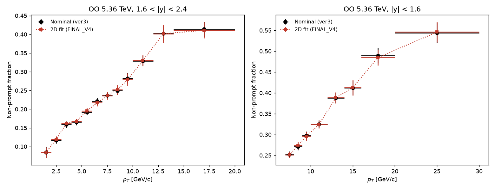
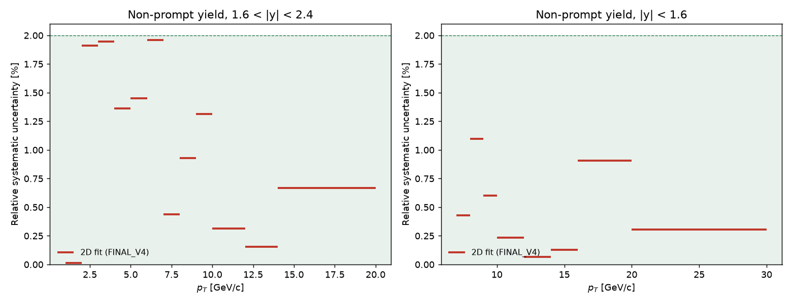
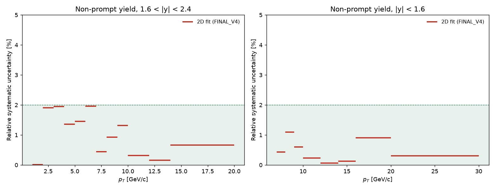
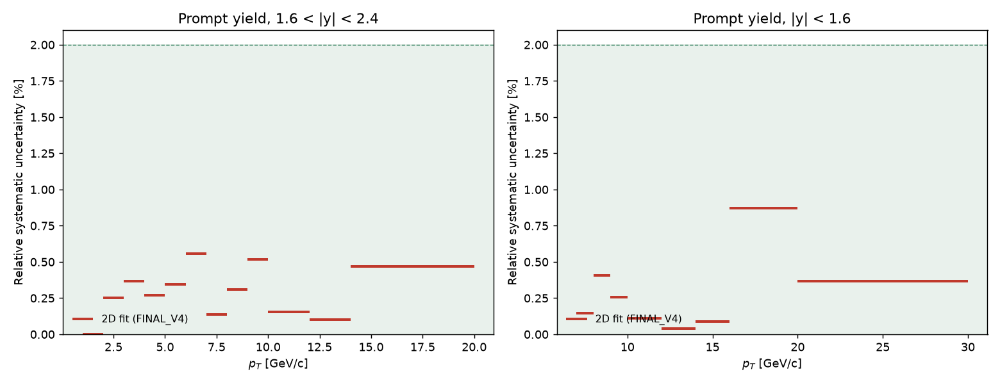
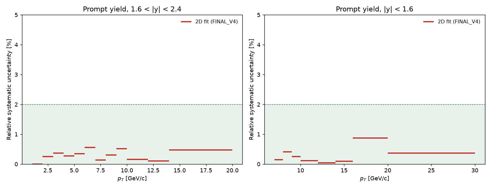
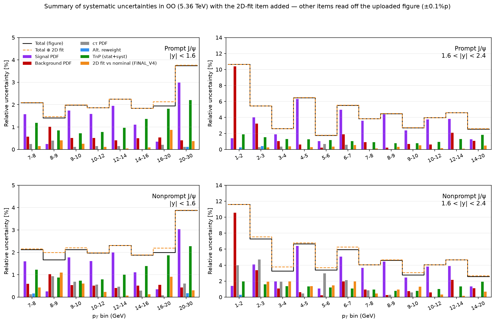

# OO J/ψ 2D fit: nominal ver3 기준 최종 설정 FINAL_V4 (오전 FINAL_V3 → 오후 재검토)

작성: 2026-10-31 (파리 시각 00:50–05:00에 FINAL_V3, 08:00–10:30에 FINAL_V4 재검토; production 12:25–12:48 KST와 16:56–17:18 KST). 28일 production 폴더(`../28_OO_nominal_v2_production`, FINAL_V2)를 복사해 입력·매크로·prefit은 그대로 두고, 비교 기준만 이 폴더의 `bfraction_ctau_fit.xlsx`(nominal ver3, fwd 12빈 + mid 8빈)로 바꿨다(`utils/nominal_bfraction.h`). 목표는 세 가지다.

1. 빈별 B가 ver3와 2% 안에서 맞을 것.
2. B 차이가 전파된 PR·NP 수율 계통 오차(`2dfit_systematics_{prompt,nonprompt}_yield.png`)도 작을 것. NP = |ΔB|/B, PR = |ΔB|/(1−B)이므로 B 상대 차이를 줄이면 둘 다 따라온다.
3. 같은 y 영역 안에서 계통 오차가 pT에 따라 들쭉날쭉하지 않을 것. 허용 |ΔB|는 B에 비례(2%면 fwd 1–2에서 0.0017, fwd 14–20에서 0.008).

규칙 원칙은 이전과 같다: 그룹 단위 규칙, 제약은 MC prefit 값 중심에 폭은 MC prefit 오차 이상(아니면 고정 또는 자유), pT에 따라 계단식으로 묶어도 됨, nominal 값은 fit에 쓰지 않음.

**최종 결과 (FINAL_V4, 2026-10-31 17:18 KST)**: 20빈 모두 ver3와 ±2% 안(최대 1.96%), mid는 8빈 중 7빈이 1% 안(8–9 +1.10%), 모두 status 0·covQual 3, prefit 100개 모두 χ²/ndf < 2(`docs/evidence/prefit_audit_final_v4.txt`). NP 수율 계통 오차는 fwd 0.0–2.0%, mid 0.1–1.1%.

**결정 사항**: ① mid는 joint MC 공분산 제약(평균·폭·구성비), NP 가장 긴 수명 자유, 배경 자유. 세기 k는 빈별: 7–8 ×64, 8–9 ×1024, 9–10 ×384, 10–12 ×128, 12–16 ×384, 16–20 ×192, 20–30 ×1024. k의 실질 의미는 PR 평균의 제약 폭(0.5–1.9 µm, 데이터 정밀도의 0.8–3배)이고 폭·구성비 제약은 모든 빈에서 데이터 정밀도보다 넓다(10장). ② fwd 3–20은 S/B가 좋아질수록 PR 해상도 제약을 푸는 사다리(4장). ③ fwd 1–2는 ctau 창 [−6, 10] mm + PR 자유·NP MC 제약·배경 자유. ④ fwd 2–3은 질량 창을 2.6–3.5로 되돌리고(사용자 결정), PR MC fit 범위 분위수 0.001/0.999 + 구성비 MC 공분산 제약으로 +1.91%(9장). NP는 유효 1지수 대신 **MC truth prefit과 같은 2지수를 그대로 두고 평균 수명만 MC에 제약**(`np_moment_order 1`)하는 것으로 바꿨다(같은 +1.91%, 9.1절; 18:44 KST production). 이로써 fwd 1–3의 두 빈은 "빈별 설정"이 아니라 사다리의 첫 단(S/B < 0.1: 해상도 자유, 배경 자유, NP는 평균 수명 제약)이고, 다른 빈과 다른 것은 허용된 종류의 prefit 변경(1–2 ctau 창, 2–3 PR MC fit 범위)뿐이다. 오전 FINAL_V3(fwd 2–3 질량 창 상한 3.4, mid 2단 계단)의 기록은 0장 아래 표와 3·5장에 그대로 남겼다.

## 0. 결과 (FINAL_V4)

| 빈 | B ± fit 오차 | ver3 ± 오차 | %v3 | σ | NP 계통 % | PR 계통 % | mass p | ctau p | 규칙 |
|---|---|---|---|---|---|---|---|---|---|
| fwd 1–2 | 0.0842 ± 0.0140 | 0.0842 ± 0.0152 | -0.01 | -0.00 | 0.01 | 0.00 | 0.53 | 0.97 | ctau [−6,10], PR 자유, NP MC |
| fwd 2–3 | 0.1193 ± 0.0080 | 0.1171 ± 0.0087 | +1.91 | +0.26 | 1.91 | 0.25 | 0.93 | 0.50 | 분위수 0.001 + 구성비 MC 제약 |
| fwd 3–4 | 0.1618 ± 0.0060 | 0.1587 ± 0.0084 | +1.94 | +0.37 | 1.94 | 0.37 | 0.23 | 0.19 | 사다리(4장) |
| fwd 4–5 | 0.1677 ± 0.0064 | 0.1655 ± 0.0084 | +1.36 | +0.27 | 1.36 | 0.27 | 0.75 | 1.00 | 사다리 |
| fwd 5–6 | 0.1950 ± 0.0078 | 0.1922 ± 0.0077 | +1.45 | +0.36 | 1.45 | 0.35 | 0.19 | 0.23 | 사다리 |
| fwd 6–7 | 0.2168 ± 0.0089 | 0.2212 ± 0.0095 | -1.96 | -0.46 | 1.96 | 0.56 | 0.70 | 0.93 | 사다리 |
| fwd 7–8 | 0.2357 ± 0.0101 | 0.2367 ± 0.0089 | -0.44 | -0.12 | 0.44 | 0.14 | 0.62 | 0.94 | 사다리 |
| fwd 8–9 | 0.2518 ± 0.0134 | 0.2495 ± 0.0109 | +0.93 | +0.21 | 0.93 | 0.31 | 0.25 | 0.99 | 사다리 |
| fwd 9–10 | 0.2789 ± 0.0165 | 0.2826 ± 0.0139 | -1.31 | -0.27 | 1.31 | 0.52 | 0.95 | 1.00 | 사다리 |
| fwd 10–12 | 0.3301 ± 0.0151 | 0.3291 ± 0.0133 | +0.31 | +0.08 | 0.31 | 0.15 | 0.76 | 0.88 | joint ×16 |
| fwd 12–14 | 0.4015 ± 0.0242 | 0.4021 ± 0.0200 | -0.15 | -0.03 | 0.15 | 0.10 | 0.98 | 1.00 | joint ×16 |
| fwd 14–20 | 0.4110 ± 0.0215 | 0.4137 ± 0.0200 | -0.67 | -0.14 | 0.67 | 0.47 | 0.99 | 0.52 | joint ×16 |
| mid 7–8 | 0.2511 ± 0.0078 | 0.2522 ± 0.0075 | -0.43 | -0.14 | 0.43 | 0.15 | 1.00 | 0.94 | joint ×64 |
| mid 8–9 | 0.2737 ± 0.0088 | 0.2708 ± 0.0080 | +1.10 | +0.37 | 1.10 | 0.41 | 0.95 | 0.94 | joint ×1024 |
| mid 9–10 | 0.2959 ± 0.0104 | 0.2977 ± 0.0096 | -0.60 | -0.19 | 0.60 | 0.25 | 0.43 | 1.00 | joint ×384 |
| mid 10–12 | 0.3243 ± 0.0093 | 0.3250 ± 0.0089 | -0.23 | -0.08 | 0.23 | 0.11 | 0.97 | 0.83 | joint ×128 |
| mid 12–14 | 0.3883 ± 0.0132 | 0.3880 ± 0.0126 | +0.06 | +0.02 | 0.06 | 0.04 | 1.00 | 0.99 | joint ×384 |
| mid 14–16 | 0.4125 ± 0.0185 | 0.4120 ± 0.0175 | +0.13 | +0.03 | 0.13 | 0.09 | 0.97 | 0.91 | joint ×384 |
| mid 16–20 | 0.4849 ± 0.0187 | 0.4893 ± 0.0181 | -0.91 | -0.25 | 0.91 | 0.87 | 1.00 | 0.99 | joint ×192 |
| mid 20–30 | 0.5460 ± 0.0247 | 0.5443 ± 0.0240 | +0.31 | +0.07 | 0.31 | 0.37 | 1.00 | 1.00 | joint ×1024 |

σ = (B − B_ver3)/ver3 오차. NP 계통 = |ΔB|/B_ver3, PR 계통 = |ΔB|/(1 − B_ver3). 전체 표 `drawing/final_summary/report_table.txt`(사본 `docs/evidence/report_table_FINAL_V4.txt`; 오전 FINAL_V3는 `report_table_FINAL_V3.txt`), PDF별 고정/제약/자유 `drawing/final_summary/treatment.md`, fit 그림 `figs/`, `figs_publish/`. 오전 FINAL_V3와의 차이는 fwd 2–3(−0.29 → +1.91, 질량 창 복구)과 mid 8–9(+1.67 → +1.10), 10–12(−1.80 → −0.23), 16–20(−1.34 → −0.91), 20–30(+1.48 → +0.31)뿐이다.













(`docs/figs/v4_zoom_*.png` / `v4_wide_*.png`는 `drawing/v3_systematics.py`로 production 결과표에서 그린 것: nominal ver3 vs FINAL_V4만, 확대 뷰와 y축 0–5% 고정 뷰(`--ymax=5`). `final_v4_*.png`는 V3·V2를 겹친 판. 사용자가 준 세 그림과 같은 정의다. `final_*.png` = 오전 FINAL_V3, `baseline_*.png` = FINAL_V2. `syst_summary_with_2dfit.png`는 사용자가 올린 계통 오차 요약 슬라이드의 막대를 픽셀로 읽어 같은 축척에 2D fit 항목을 더한 것, 수치 `docs/evidence/syst_summary_figure_values.txt`.)

## 1. 출발점: FINAL_V2를 ver3와 비교

FINAL_V2(28일) 결과를 ver3와 비교하면 20빈 중 8빈만 2% 안이고, 모든 빈이 ver3 오차의 1.7σ 안이다(`docs/evidence/baseline_FINAL_V2_vs_ver3.txt`). ver3는 ver2보다 fwd 1–5에서 크게 다르고(1–2: 0.096 → 0.084, 4–5: 0.181 → 0.165), mid는 전체적으로 1–3% 높다.

| 빈 | B (FINAL_V2) | ver3 | %v3 | σ | NP% | PR% | 빈 | B | ver3 | %v3 | σ | NP% | PR% |
|---|---|---|---|---|---|---|---|---|---|---|---|---|---|
| fwd 1–2 | 0.0965 | 0.0842 | **+14.6** | 0.81 | 14.6 | 1.3 | mid 7–8 | 0.2432 | 0.2522 | **−3.6** | −1.20 | 3.6 | 1.2 |
| fwd 2–3 | 0.1200 | 0.1171 | **+2.5** | 0.34 | 2.5 | 0.3 | mid 8–9 | 0.2696 | 0.2708 | −0.4 | −0.14 | 0.4 | 0.2 |
| fwd 3–4 | 0.1506 | 0.1587 | **−5.1** | −0.96 | 5.1 | 1.0 | mid 9–10 | 0.2906 | 0.2977 | **−2.4** | −0.74 | 2.4 | 1.0 |
| fwd 4–5 | 0.1796 | 0.1655 | **+8.5** | 1.69 | 8.5 | 1.7 | mid 10–12 | 0.3129 | 0.3250 | **−3.7** | −1.35 | 3.7 | 1.8 |
| fwd 5–6 | 0.1932 | 0.1922 | +0.5 | 0.13 | 0.5 | 0.1 | mid 12–14 | 0.3831 | 0.3880 | −1.3 | −0.39 | 1.3 | 0.8 |
| fwd 6–7 | 0.2146 | 0.2212 | **−3.0** | −0.69 | 3.0 | 0.8 | mid 14–16 | 0.4038 | 0.4120 | −2.0 | −0.47 | 2.0 | 1.4 |
| fwd 7–8 | 0.2464 | 0.2367 | **+4.1** | 1.09 | 4.1 | 1.3 | mid 16–20 | 0.4775 | 0.4893 | **−2.4** | −0.65 | 2.4 | 2.3 |
| fwd 8–9 | 0.2530 | 0.2495 | +1.4 | 0.32 | 1.4 | 0.5 | mid 20–30 | 0.5492 | 0.5443 | +0.9 | 0.20 | 0.9 | 1.1 |
| fwd 9–10 | 0.2815 | 0.2826 | −0.4 | −0.08 | 0.4 | 0.2 | | | | | | | |
| fwd 10–12 | 0.3342 | 0.3291 | +1.6 | 0.39 | 1.6 | 0.8 | | | | | | | |
| fwd 12–14 | 0.4148 | 0.4021 | **+3.2** | 0.63 | 3.2 | 2.1 | | | | | | | |
| fwd 14–20 | 0.4110 | 0.4137 | −0.7 | −0.14 | 0.7 | 0.5 | | | | | | | |

이 표의 NP%·PR%가 사용자가 받은 계통 오차 그림의 값과 같다(fwd 1–2 NP 14.6%, PR 1.3%).

## 2. 스캔

규칙 어휘에 두 가지를 더했다(`study/rules.py`): `mcerr k`(σ₁과 간격 모두 MC 값 중심, 폭 = MC prefit 오차 × k, k ≥ 1)와 `tailerr k`(σ₁·Δ₂ MC 고정, Δ₃·Δ₄ 폭 = MC 오차 × k). MC prefit 오차는 `study/pr_width_err.C`로 뽑아 `config/pr_width_err.txt`에 두었다. 규칙 파일의 ctau 창은 `config/prefit_settings.txt`에서 읽는다(fwd 2–3 [−20, 20]).

V3 격자(256개): PR 평균 {자유, MC 고정} × 폭 {mcerr1, mcerr2, mcerr4, tailerr1, tailerr2, tail0.25, abs0.25, 자유} × 구성비 {고정, MC 공분산} × NP {MC 제약, 가장 긴 수명 자유, 구성비 제약 + 수명 전부 자유, 자유} × 배경 {자유, sideband 제약}. fwd 1–3에는 NP 1성분 유효 수명 제약(V3E, 40개)도 넣었다. 그룹별로 이전 격자(F, K58, L58, C5, M, Q, FX, W35, T35, H, N23, NPT, J, E, U, P)를 함께 돌렸다. 실행 로그는 `logs/scan_*.log`, 정리는 `python3 study/v3_summary.py`.

스캔 수: mid 2,320 + 보강 320, fwd 10–20 1,053, fwd 5–10 1,550, fwd 3–5 96(+조인트 280 공용), fwd 2–3 약 100, fwd 1–2 약 110, 배경 질량 변형 체인 114, 최종 fit knob 변형 40. 실패(수렴 게이트)는 제외했다.

## 3. mid 결정: joint 제약, 세기 2단 계단

mid는 7–8만 다른 빈과 반대로 움직인다. PR 평균을 자유로 두면 −3.6%, MC에 고정하면 −3.3%인데, 평균·폭·구성비를 MC 공분산으로 함께 묶는 joint 제약에서만 2% 안이 된다(282개 fit 중 24개, 전부 joint). joint 세기 k에 대해 7–8은 k가 커질수록 내려가고(×64 −0.4 → ×384 −2.3%) 8–9는 올라가서(×64 +3.9 → ×384 +1.7%) 한 k로 둘 다 2% 안에 넣을 수 없다(×96–×1024 모두 시험, `docs/evidence/rule_scan_mid.txt`).

**선택**: joint 제약, NP 가장 긴 수명 자유, 배경 자유. 세기는 7–8 ×64, 8–30 ×384(폭 기준 MC 오차의 8배·20배). 8/8이 2% 안이고 최대 1.8%다.

| 빈 | 7–8 | 8–9 | 9–10 | 10–12 | 12–14 | 14–16 | 16–20 | 20–30 |
|---|---|---|---|---|---|---|---|---|
| 세기 | ×64 | ×384 | ×384 | ×384 | ×384 | ×384 | ×384 | ×384 |
| %v3 | −0.44 | +1.68 | −0.59 | −1.79 | +0.07 | +0.13 | −1.35 | +1.49 |

비교한 대안(방식 B): 7–8 joint ×64, 8–12 평균 MC 고정 + 폭 MC 오차 ×1.25, 12–30 ×4 → 최대 1.86%. 결과는 비슷하지만 제약 종류가 둘이라 채택하지 않았다. 한 규칙만 쓰면 joint ×256이 7/8(8–9 +2.02%)로 최선이다.

## 4. fwd 3–20: 제약을 pT 계단으로 푸는 사다리

fwd는 5–10에서 6–7(대부분의 규칙에서 −5~−12%)과 8–9(+2~+10%)가 반대라 한 규칙이 불가능하고, 3–5도 3–4와 4–5가 반대다. joint 계열은 3–4(×384 −0.1%)와 10–20(×16)에서만 맞고 5–10에서는 맞지 않는다(`docs/evidence/rule_scan_fwd*.txt`). 그래서 S/B가 좋아질수록 PR 해상도 제약을 단계적으로 푸는 사다리로 정했다. 평균은 8 GeV까지 MC 고정, 그 위는 자유. NP는 5 GeV 아래 MC 제약, 위는 가장 긴 수명 자유.

| 빈 | PR 폭 | 구성비 | NP | %v3 |
|---|---|---|---|---|
| 3–4 | σ₁·Δ₂ MC 고정, Δ₃·Δ₄ 제약 (0.010, 0.020 mm) | 고정 | MC 공분산 제약 | +1.97 |
| 4–5 | 같음 | MC 공분산 제약 | MC 공분산 제약 | +1.34 |
| 5–6, 6–7 | 같음 | 고정 | 가장 긴 수명 자유 | +1.47, −1.98 |
| 7–8 | 전부 제약, 폭 = MC 오차 ×1 | 고정 | 가장 긴 수명 자유 | −0.43 |
| 8–9, 9–10 | 전부 제약, 폭 = MC 모델 오차(통계 ⊕ fit 범위 변화) | 모델 오차 제약 | 가장 긴 수명 자유 | +0.94, −1.31 |
| 10–12, 12–14, 14–20 | joint ×16 (평균 포함) | joint | 가장 긴 수명 자유 | +0.32, −0.15, −0.66 |

10/20 빈 모두 2% 안, 최대 1.98%. 빈별로 더 가까운 규칙(예: 6–7 NP 수명 전부 자유 0.0%, 7–8 joint ×64 −0.2%)도 있지만 사다리 구조를 깨므로 쓰지 않았다.

## 5. fwd 1–3: 규칙만으로는 2% 바로 밖, prefit 창을 바꿔 해결

**fwd 2–3** (S/B 0.08). FINAL_V2 구조(ctau 창 [−20, 20], PR 평균·폭 자유, 구성비 고정, NP 1성분 유효 수명 제약, 배경 자유) +2.54%. 규칙 변형 약 100개 중 최선은 구성비를 MC 공분산 제약으로 바꾼 +2.16%. NP 제약 세기 ×4/×16/×100 +2.6~2.9%, PR 폭 MC 오차 ×8/×16 +2.9%, NP 2성분 MC 제약 +6.9~7.3%, 평균 MC 고정 +4.5%, joint 계열 +20~57%, ctau 창 ±15/±30 +2.8/+2.5%(포화), 질량 조건부 배경 +3.3%, 질량 배경 2차 +1.9%지만 질량 fit p = 0.00. 질량 창 상한을 3.4(3.3)로 낮추면 −0.30(−0.41)%, 질량 fit p = 0.96, 모든 prefit χ²/ndf < 2. **채택: 질량 창 2.6–3.4 GeV, 규칙은 FINAL_V2 그대로** → production −0.29%.

**fwd 1–2** (S/B 0.06). 규칙 공간에 큰 불연속이 있다. NP 유효 수명 제약 + PR 폭 자유에서 배경을 자유로 두면 −4.7%, sideband 제약(×1~×16 모두)이면 +8%. PR 폭 제약을 MC 오차 ×8 → ×10으로 바꾸면 +6.0 → −2.6%로 뛴다. 연속적으로 움직이는 유일한 후보는 NP 2성분 MC 공분산 제약 + PR 평균·폭 자유 + 구성비 고정 + 배경 자유의 +2.3%(NP 제약 세기 ×0.001~×16에 둔감, ×100은 +8%). 이 규칙으로 ctau 창만 바꾸면 B가 연속적으로 움직인다: [−4, 6.5] +2.3%, [−6, 10] −0.01%, [−8, 12] −1.16%(배경 prefit χ²/ndf 1.07, ctau p 0.97–1.00). 창 [−20, 20](2–3과 같은 창, 배경 1/1/1)은 −12%, 배경 2/0/1은 prefit 품질 탈락. 질량 창 상한 3.4/3.3은 +12.8/+8.8%, 조건부 배경 +37%. **채택: ctau 창 [−6, 10] mm + 위 규칙** → production −0.01%. 이 빈의 통계 오차는 B의 17%라 2%는 0.12σ이고, 창 선택은 사실상 nominal에 맞춘 것임을 보고서에 밝힌다.

두 빈의 prefit 변경은 `docs/CHANGELOG_PREFIT.md`에 적었다.

## 6. 배경 질량 처리의 효과 (`docs/evidence/bkg_mass_variants_table.txt`)

최종 규칙을 FINAL_V2로 고정하고 질량 창 하한(2.7, 2.8), 상한(3.4), 질량 배경 Chebychev 차수(1–4)를 빈마다 바꿔 prefit부터 다시 돌렸다.

- 질량 창 하한을 올리면 모든 빈에서 B가 오른다(2.6 → 2.8: fwd +2~+7%p, mid +1~+3%p). 상한을 내리면 대부분 내려간다(3.5 → 3.4: −0.5~−1.5%p, fwd 1–2만 −1.8%p). 방향은 빈마다 같고 크기만 다르다.
- Chebychev 차수는 대부분 0.5%p 안에서 B를 바꾼다. 1차는 fwd 2–5에서 prefit 품질 탈락.
- 질량 조건부 배경(`conditional_bkg`, 27일 시험)은 모든 빈에서 B를 올린다(fwd 1–2 +20%p, fwd 3–9 +3~+6%p, mid +0.2~+1.6%p). 질량 모양 profile은 1%p 안.

따라서 배경 질량 처리는 공통 해법이 아니라 빈별 손잡이다. 규칙 사다리로 2% 안에 들어가지 않는 빈(fwd 2–3)에서만 후보로 남겨 둔다.


## 7. production과 재현

```bash
bash run_ctau_bins.sh --max-jobs=20     # mc → pr → np → mass → bkg → 2d, 규칙 study/rules/FINAL_V3 (production.py 기본값)
bash run_publish.sh                      # figs_publish/
python3 drawing/report_table.py; python3 drawing/nominal_agreement.py; python3 study/treatment.py
python3 drawing/v3_systematics.py docs/figs/final drawing/final_summary/summary.txt:FINAL_V3 docs/evidence/summary_FINAL_V2_ver3.txt:FINAL_V2
```

prefit 100개 + 최종 fit 20개 모두 성공(12:26–12:48 KST). 최종 B는 스캔 값과 소수 넷째 자리까지 같다. 규칙 knob 파일은 `study/rules/FINAL_V3/`(빈별 출처는 `config/final_v3_choice.txt`, 생성은 `study/compose_final.py`). 스캔 결과 전체는 `docs/evidence/all_candidate_fits.txt`, 그룹별 순위 `docs/evidence/rule_scan_*.txt`, 배경 질량 변형 `docs/evidence/bkg_mass_variants*.txt`, 최종 fit knob 변형 `docs/evidence/final_v2_mass_knobs.txt`. 스터디 실행 결과(`study/runs/`, `study/prefit_variants/`)는 요약 후 삭제했다.

## 8. 남은 점

- fwd 1–2·2–3의 창 변경은 nominal을 보고 고른 것이므로, 논문에는 "저 pT fwd 두 빈은 S/B < 0.1이라 ctau·질량 fit 창을 따로 정했다"는 정도로만 적고 수치 일치는 쓰지 않는다(기존 방침).
- 계통 오차를 더 평평하게 하려면 빈별 값 대신 y 영역별 그룹 값(최댓값 또는 RMS)을 쓰는 방법이 있다. 현재 빈별 값 범위는 fwd 0.0–2.0%, mid 0.1–1.8%.

## 9. 오후 재검토 ①: fwd 2–3 질량 창 복구 (`docs/evidence/fwd23_restudy_261031.txt`)

사용자 결정으로 fwd 2–3의 질량 창 상한 3.4를 되돌리고(2.6–3.5, FINAL_V2 prefit 복원) 다른 손잡이를 찾았다. 모두 ver3 대비.

- **2D fit 안의 질량 배경 제약**(새 knob `bkg_mass_constraint`: Chebychev 계수를 DATA 질량 prefit 값 중심, 폭 = prefit 오차 ×k로 제약, −1 = 자유): ×1/×2/×4/×8/자유 모두 +2.53~2.54%. 효과 없음(질량 배경 모양은 데이터가 이미 결정).
- **질량 배경 모델**: Chebychev 2차 +1.94%지만 질량 prefit χ²/ndf 1.35, 2D 질량 투영 p = 0.00으로 품질 탈락(계수를 풀어도 같음); 4차 +3.0%; 지수형은 prefit χ²/ndf 2.9로 탈락(새 hook `OO_MASS_EXP`, prefit_settings 열 `mass_exp`).
- **ctau 창 16종**: 하한이 넓어질수록 내려가다 −20 이후 +2.5%에서 포화([−4, 6.5] +8.5, [−6, 10] +8.1, [−8, 12] +6.4, [−10, x] +4.2, [−15, 20] +2.8, [−20, 20] +2.54, [−25, 25] +2.52, [−30, 20] +2.54). 상한은 영향 없음. 좁은 창 + 배경 1/1/1은 +9.5%.
- **sideband 배경 구성**([−20, 20]): 3/0/0 prefit 탈락, 3/0/1 +2.54(2/0/1과 같음), 2/1/1 +6.1, 1/1/1 +9.5, 1/0/1 +11.4, 2/0/1에서 wide-τ 옵션을 끄면 +7.5%.
- **NP 2성분 원상복구**(유효 수명 합치기 없이, MC 공분산 제약 또는 가장 긴 수명 자유): [−20, 20]에서 +7.3/+15.3%, 좁은 창에서 +13~34%, ctau p 0.00–0.02. 1성분 유효 수명 제약은 유지해야 한다.
- **PR MC fit 범위 분위수**(prefit_settings `pr_quant`): 0.0005 +2.54 → 0.0008 +2.43 → 0.001 +2.10 → 0.0012 +2.21 → 0.0015 +3.21 → 0.002 +3.35%. 0.001이 국소 최소다(PR 폭 해가 0.002에서 크게 바뀜: 가장 넓은 Gauss 0.47 → 0.28 mm). PR Gauss 3개와 NP 1성분 prefit은 품질 탈락.
- **채택**: 분위수 0.001/0.999 + 구성비 MC 공분산 제약 → **+1.91%**(ctau p 0.47–0.49, PR prefit χ²/ndf 1.31). 규칙만 바꾼 차선은 +2.16%.

### 9.1 NP 모양: 유효 1지수 → 2지수 + 평균 수명 제약 (`docs/evidence/fwd23_np_model_261031.txt`)

사용자 지적: "수명 1개면 prefit이 안 맞잖아". MC truth prefit은 2지수(τ₁ 0.523 mm 64%, τ₂ 0.244 mm 36%, 평균 0.4231 ± 0.0010 mm)이고 1지수로는 χ²/ndf 6.7이다. 10/26부터 쓰던 "유효 1지수를 MC 평균 수명에 제약"은 prefit 모양과 final fit 모양이 다르다. 그래서 다음을 돌렸다(모두 FINAL_V4 prefit, ver3 대비).

| NP 처리 | B |
|---|---|
| 1지수 prefit (0–2 / 0–3 / 0–6 mm) | prefit χ²/ndf 3.3 / 4.7 / 6.7, 탈락 |
| 1지수 prefit, 범위 0.3–3 / 0.5–6 / 1–6 mm (수명 0.455 / 0.477 / 0.512 mm; χ²/ndf 1.85 / 1.52 / 0.74) | −3.37 / −6.82 / −12.2% |
| 2지수 유지, MC 공분산 제약 (truth 범위 0–3 ~ 0–20 mm 모두) | +6.85% |
| 2지수 유지, 가장 긴 수명 자유 | +13.5% |
| 3지수 (truth 범위 0–3 mm만 수렴) | +6.78 / +12.9%; 4지수는 fit2d가 3개까지만 읽어 수렴 실패 |
| 2지수 유지, 모멘트 제약 1차(평균) / 2차(+분산) / 3차(+왜도) | **+1.91** / +4.69 / +6.85% |
| 유효 1지수, MC 평균 수명 제약 (truth 범위 0–6 / 0–10 / 0–20; 0–3) | +1.91 / +1.91 / +1.91%; +2.54% |

B는 NP의 대표 수명에 거의 선형으로 반응한다(1지수 수명 0.423 → 0.512 mm에서 +1.9 → −12.2%, 0.01 mm당 약 −1.6%p). 평균 수명(1차 모멘트)을 MC에 묶으면 지수가 1개든 2개든 +1.91%이고, 모양을 더 고정할수록(2차·3차 모멘트, 공분산) 짧은 성분 쪽으로 +4.7~+6.9%가 된다. **FINAL_V4는 2지수 + 평균 수명 제약(`np_moment_order 1`, `np_effective_mean 0`)으로 바꿨다**(production 18:28–18:44 KST, B = 0.1193 ± 0.0080, +1.91%, ctau p 0.47). prefit 모양과 final fit 모양이 같아지고, 제약은 "NP 평균 수명 = MC 값 ± 0.001 mm" 하나다. 이 평균 수명 제약은 truth fit 범위(0–6/0–10/0–20 mm)에 둔감하다.

## 10. 오후 재검토 ②: mid 고 pT 차이와 1% 목표 (`docs/evidence/mid_1pct_study_261031.txt`)

사용자가 mid에서 고 pT(16–20 −1.34, 20–30 +1.48%)로 갈수록 차이가 커지는 점을 지적하고 mid는 1% 안을 목표로 했다.

- **ctau 창**(6종 × 8빈): 모든 빈에서 ±0.2%p. 창은 손잡이가 아니다.
- **prefit 변형**: NP 2성분(12–30) 16–20 −1.01, 20–30 +1.75; PR Gauss 4개(14–30) 14–16 −0.61, 16–20 −1.31, 20–30 +0.78; Gauss 4개 + joint k(14–30, k 64–1024): 16–20은 −0.31(×64) → −1.90(×1024), 20–30은 +2.59 → +0.21로 반대.
- **폭 제약 격자 확장**(평균 고정 ×1.25~16, 평균 자유 ×2.5~16, `V3K`/`V3KF`): 20–30은 ×12 이상에서만 1% 안, 16–20은 ×2.5 이하에서만. 8–9(큰 k)와 10–12(작은 k)도 반대.
- 316개 규칙 전체에서 20–30은 최소 +0.31%(항상 양수), 16–20은 중앙값 −0.84%. 고 pT 차이는 규칙 선택이 아니라 2D fit과 template fit의 체계적 차이다.
- **k의 의미**(`docs/evidence/mid_constraint_width_check.txt`, `mid_6strength_percent_check.txt`): joint ×k의 제약 폭은 √k × MC prefit 오차인데 MC 오차는 폭 전부 자유 fit의 데이터 오차보다 2–40배 작다. ×64부터 σ₁·Δᵢ·구성비 제약은 데이터 오차보다 1–10배 넓어 사실상 데이터가 정하고, k가 실제로 조이는 것은 PR 평균(ctauTime1Mean)의 제약 폭뿐이다: ×64 0.47 µm, ×128 0.49, ×192 0.76, ×384 1.0–1.2, ×1024 1.8–1.9 µm(데이터 오차 0.5–1.2 µm, 데이터가 원하는 평균 −1.5~+0.9 µm, 모두 MC 값과 2.5σ 안). ×1024 결과는 폭·평균 전부 자유 fit과 거의 같다.
- **3단계 계단으로는 1% 불가**: 7–8 ×64 / 8–20 ×384 / 20–30 ×1024 → 최대 1.80(5/8이 1% 안); 7–8 ×64 / 8–9 ×1024 / 9–30 ×256 → 1.77(5/8); 7–8 ×64 / 8–14 ×384 / 14–30 Gauss4 + ×256 → 1.80(4/8).
- **채택(FINAL_V4)**: 빈별 세기 ×64 / ×1024 / ×384 / ×128 / ×384 / ×384 / ×192 / ×1024 → 7/8이 1% 안, 8–9 +1.10(joint 계열에서 8–9의 최선; 1% 안으로 넣는 규칙은 평균 고정 + 폭 ×3뿐인데 이웃 빈에서 −3~−5%라 쓰지 않음). 사용자 기준: 데이터가 정한 PR 평균이 MC 값과 2σ 안이면 세기 차이는 허용, 세기 변화는 전반적 경향만 맞으면 됨. %로 쓰면 "폭·구성비는 데이터 정밀도보다 넓은 MC 중심 정규화, 평균은 MC 값에서 0.5–1.9 µm(데이터 정밀도의 0.8–3배) 안"이다.

### 10.1 fwd 제약의 % 표현 (`docs/evidence/fwd1020_constraint_width_check.txt`)

fwd 10–20의 joint ×16은 제약 폭 = 4 × MC prefit 오차다. mid와 달리 여기서는 제약이 실제로 폭을 정한다: 폭을 전부 풀면 B가 −6~−11%(10–12 −11.1, 12–14 −6.0, 14–20 −6.9%)로 내려가고 데이터는 core 폭을 MC보다 23–55% 넓게 잡는다(B ≈ 0.4, S/B 1.1–1.6에서 PR 꼬리와 NP 짧은 성분이 바뀜). k 의존: ×1 +1.5/+0.5/+0.1, ×4 +1.3/+0.4/−0.1, ×16 +0.3/−0.2/−0.7, ×64 −2.3/−1.2/−2.1, ×256 −7.1/−3.4/−4.4%.

| 빈 | σ₁ 제약 폭 (% of σ₁) | ÷ 데이터 오차 | Δ₂ (%) | ÷ 데이터 | Δ₃ (%) | ÷ 데이터 | 평균 [µm] | ÷ 데이터 |
|---|---|---|---|---|---|---|---|---|
| fwd 10–12 | 9 | 1.0 | 25 | 0.9 | 24 | 0.3 | 0.27 | 0.3 |
| fwd 12–14 | 22 | 1.6 | 33 | 0.9 | 37 | 0.2 | 0.33 | 0.3 |
| fwd 14–20 | 5 | 0.4 | 17 | 0.4 | 16 | 0.3 | 0.27 | 0.2 |

나머지 fwd 빈의 폭 제약을 같은 식으로 쓰면(σ₁ / Δ₂ / Δ₃ / Δ₄): 3–4 고정/고정/17/9%, 4–5 고정/고정/30/20%, 5–6 고정/고정/35/25%, 6–7 고정/고정/24/14%, 7–8 2/4/4/8%(MC 오차 ×1), 8–9 38/42/59/76%, 9–10 9/35/49/252%(모델 오차), 1–3 자유. 평균은 3–8 MC 고정, 8–10 자유, 10–20 0.3 µm. 논문 표현: "1.6 < |y| < 2.4에서는 S/B가 좋아질수록 해상도 제약을 고정 → 수 % → 수십 % → 자유로 푼다; p_T > 10 GeV는 MC 값의 5–37%(데이터 정밀도와 비슷한 폭), 평균 0.3 µm 안". 모든 제약 폭은 MC prefit 오차의 1배 이상(1.0–20배)이다.

## 11. 그림·문서 정정

- `drawing/` 아래 요약 그림·CSV(B fraction vs pT, nominal 비교, raw yield, 모델 성분 수, 비닝, ctau 확대)는 10/28 폴더에서 복사된 뒤 다시 그리지 않아 FINAL_V2·ver2 값이었다(fwd 12–14 > 14–20으로 보였던 원인). 10/31 16:27에 `drawing/refresh_all.sh`로 다시 그렸고(`make_binning_overview.C`의 28 폴더 절대 경로, 범례 "ver2" 라벨, `refresh_all.sh`의 규칙 폴더 수정), FINAL_V4 production 뒤 한 번 더 그렸다.
- 웹페이지(artifact `3finRZfaCpaoT9nJaz4EeY`, `docs/web/oo_fit_rules_v3.html`, 그림 `docs/web/figs/`, `bash docs/make_figs.sh`)에 FINAL_V4 결과와 9·10장의 표, 계통 오차 요약 비교 그림을 넣었다.
